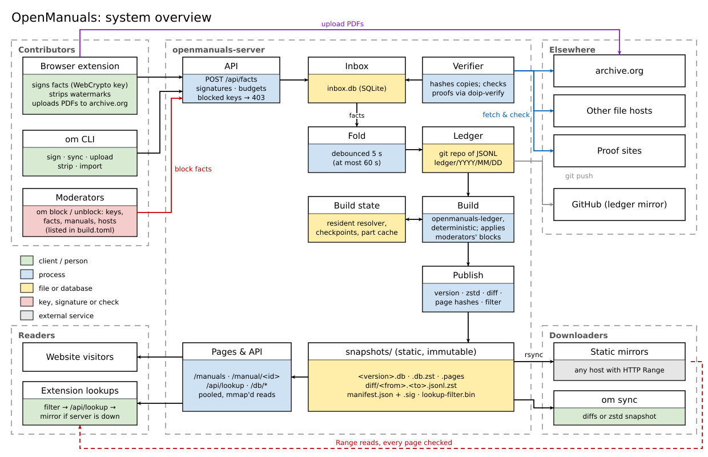
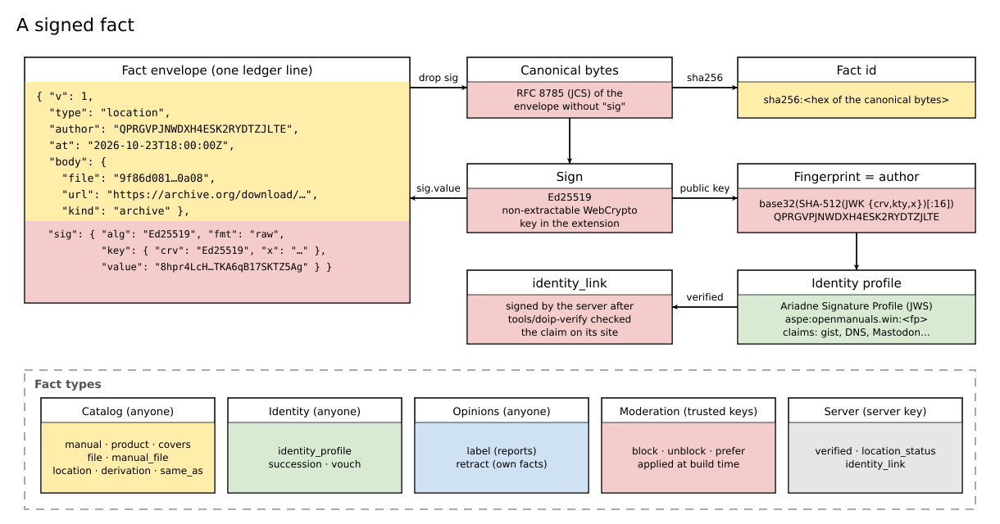
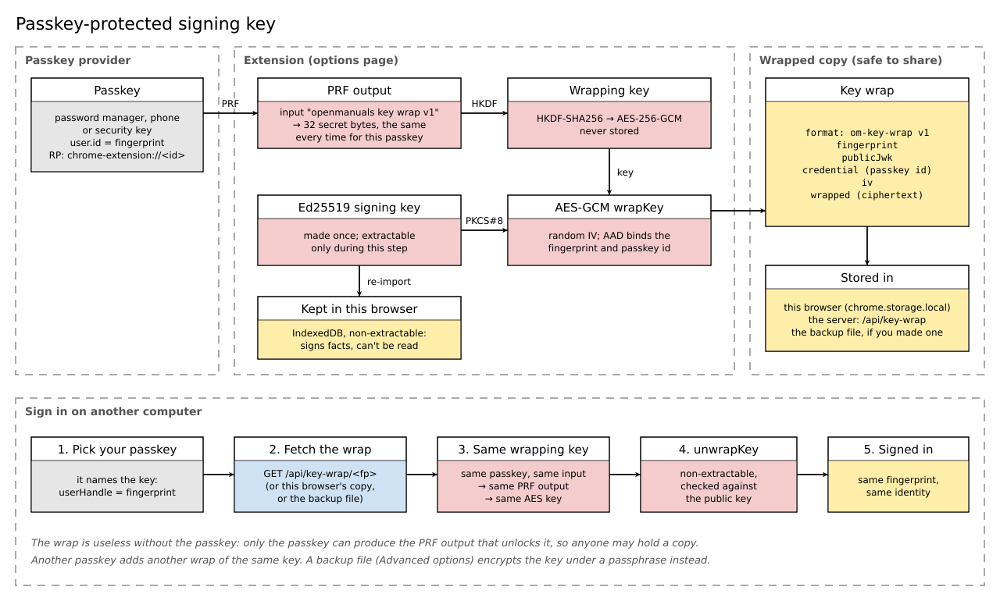
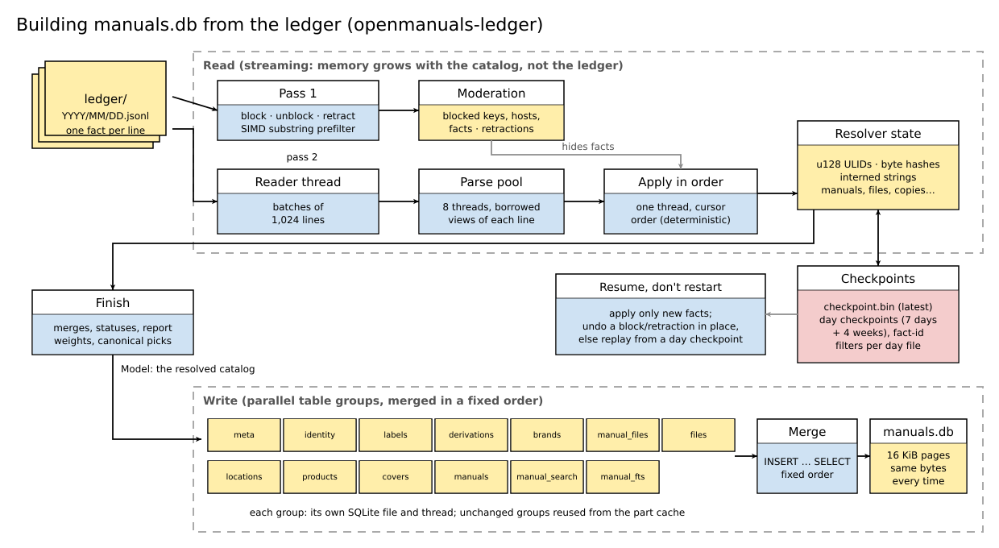
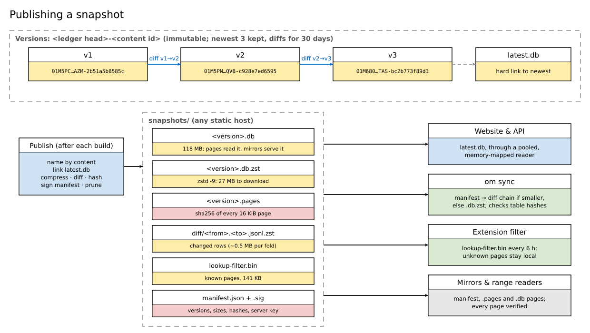
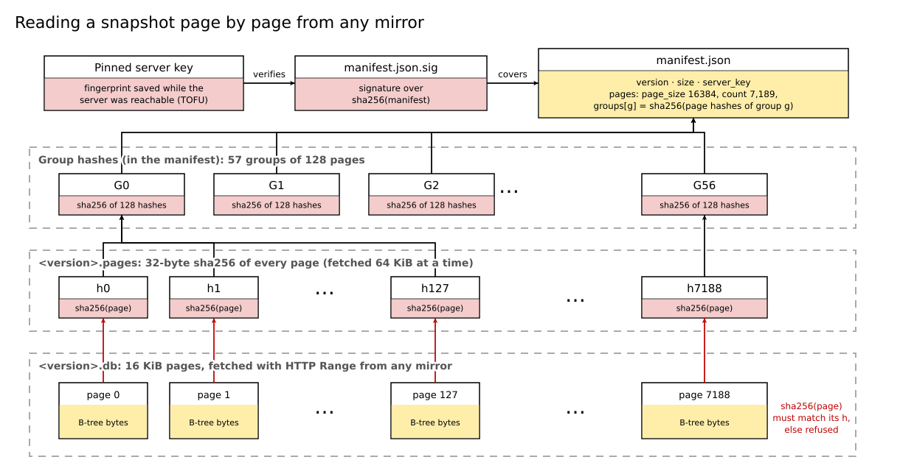
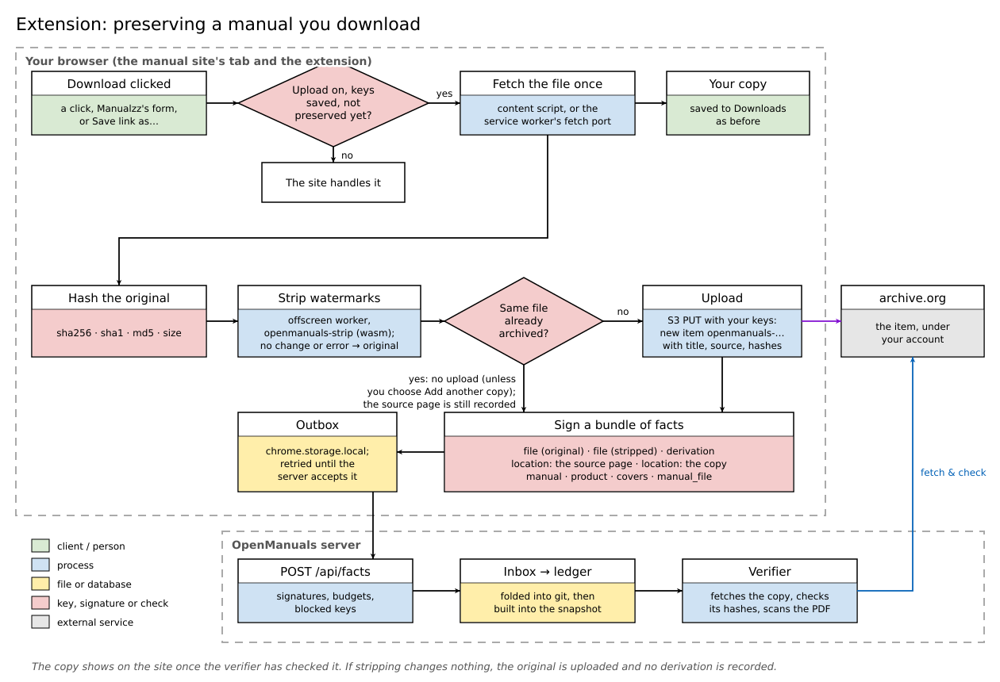
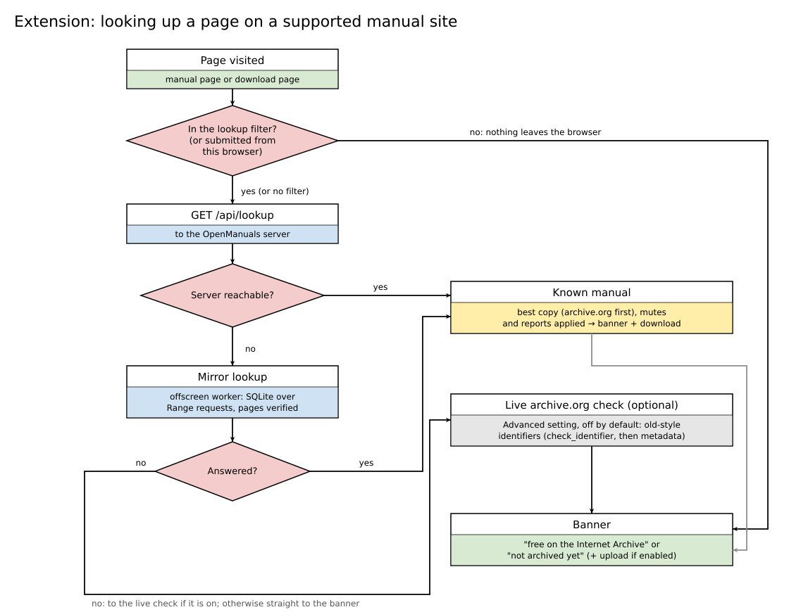

# OpenManuals

OpenManuals is a metadata catalog of device manuals (service manuals, user
manuals, schematics, etc.) that are free to download.

Using our browser extension, when you download a manual from closed sites like
ManualsLib, Elektrotanya, Manualzz, or FreeServiceManuals.info, the manual is
transparently mirrored to the Internet Archive and the OpenManuals database is
updated with that file's information.

Then, the next time someone is looking for that manual, they can locate it at
the Internet Archive directly, without needing to visit those closed sites with
their advertisements and the modifications that they perform to the original
files.

OpenManuals never hosts the PDFs directly. Files live on archive.org or on any
other host whose copy has been fetched and checked byte for byte. What
OpenManuals keeps is a ledger of signed facts about those files (which manual
they are, which products they cover, where copies are) and a database built from
it that anyone can rebuild and check. In this way, OpenManuals can track which
manuals on the closed manuals sites have been mirrored, and which haven't.

There are also no OpenManuals accounts. Contributors sign what they add with a
key that the extension creates for them and protects with a passkey. To
establish identity trust, users can optionally link their key to accounts
elsewhere (GitHub, Mastodon, a website) using Keyoxide proofs.

The latest database snapshot can be downloaded at any time from the website.



## Contents

1. [Principles](#principles)
2. [Running it](#running-it)
3. [Facts](#facts)
4. [Identity](#identity)
5. [The ledger and the build](#the-ledger-and-the-build)
6. [Publishing, sync and mirrors](#publishing-sync-and-mirrors)
7. [The server](#the-server)
8. [The verifier](#the-verifier)
9. [archive.org](#archiveorg)
10. [The browser extension](#the-browser-extension)
11. [The CLI](#the-cli)
12. [Bootstrapping the catalog](#bootstrapping-the-catalog)

The diagrams are in [`docs/diagrams/`](docs/diagrams/), generated by
`python3 docs/diagrams/make.py` (standard library only); rerun it when the
architecture changes.

## Principles

- **No OpenManuals accounts.** A contributor is a signing key. Everything else
  about a person is a claim they choose to prove.
- **Accept facts, moderate after.** The server checks signatures and stores
  every fact it accepts; what the public sees is decided when the database is
  built. The only facts turned away at the door are those from keys a
  moderator has blocked (403) and those over a key's daily budget (429).
- **An append-only ledger of signed facts plus a deterministic build.** The same
  ledger and trust configuration always give the same bytes, so anyone can
  rebuild the snapshot and check it against the published checksum.
- **archive.org first, any host allowed.** archive.org is the first-class upload
  target, but any host can hold a copy. A copy is shown only after its bytes
  have been verified.
- **One implementation of the fact format.** The Rust crate `openmanuals-core` is used by
  the server, the CLI and the browser extension (via WebAssembly).

| Component | What it is |
|---|---|
| `crates/openmanuals-core` | Facts, RFC 8785 canonical JSON, ids, keys and fingerprints, identity profiles, archive.org identifiers, page parsing, product keys, the lookup filter. wasm-safe. `vectors/vectors.json` is the cross-language conformance suite. |
| `crates/openmanuals-ledger` | The JSONL ledger and the deterministic build of `manuals.db`; snapshot hashes, diffs and page hashes. |
| `crates/openmanuals-server` | The `openmanuals-server` binary: facts inbox, feed, lookup, snapshot files, identity hosting, pages, fold, publishing, verifier. |
| `crates/openmanuals-cli` | The `om` binary: keys, signing, sync, builds, uploads, stripping, re-stripping, blocking keys (moderators), the one-time bootstrap and old-style archive.org imports. |
| `crates/openmanuals-wasm` | wasm-bindgen exports of openmanuals-core for the extension. |
| `crates/openmanuals-strip` | The [watermark stripper](#the-watermark-stripper), on lopdf. wasm-safe. |
| `crates/openmanuals-strip-wasm` | wasm-bindgen exports of openmanuals-strip for the extension's stripper worker. |
| `tools/doip-verify` | A Node wrapper around doipjs that the verifier shells out to for identity proofs. |
| `tools/keyoxide-provider` | A proposed doipjs provider for `https://<server>/k/<fp>` claims (see [Linking from Keyoxide](#linking-from-keyoxide)). |
| `extension/` | The browser extension (TypeScript, Manifest V3). |

## Running it

```sh
cargo build --release            # the debug build signs facts ~20x slower
cargo test --workspace
(cd tools/doip-verify && npm install)   # identity proofs; needs node
```

Quick start: run a server on a ledger (a clone of the ledger repository, or
an empty directory to start a new one):

```sh
mkdir -p data ledger
./target/release/om key init                                  # a new Ed25519 key
cp ~/.local/share/openmanuals/key data/server.key             # the server's identity
./target/release/openmanuals-server --data-dir data --ledger-dir ledger build   # build and publish a snapshot
./target/release/openmanuals-server --data-dir data --ledger-dir ledger --domain openmanuals.win \
    --public-url https://openmanuals.win --doip-script tools/doip-verify/index.js serve --bind 127.0.0.1:8000
```

Facts then arrive through the API, from the extension and from `om`. The
initial catalog was imported once from an earlier scrape, and the old-style
archive.org items once with `om import-ia-legacy`; see
[Bootstrapping the catalog](#bootstrapping-the-catalog).

The extension: see [Build, test and load](#build-test-and-load).

A container image of the server and `om` (with git, Node for the proof checks,
and sqlite3) builds from the `Dockerfile`:

```sh
docker build -t openmanuals-server .
docker run -p 8000:8000 -v openmanuals:/var/lib/openmanuals \
    -e OM_DOMAIN=example.org -e OM_PUBLIC_URL=https://example.org openmanuals-server
```

State lives in `/var/lib/openmanuals` (`data/` and `ledger/`), so mount a
persistent volume there and put the server key at `data/server.key`.

### Where things live

```
<data-dir>/            openmanuals-server state (default ./data)
  server.key           OpenSSH private key; its fingerprint is the server identity
  inbox.db             every accepted fact with its ingestion cursor (SQLite)
  keywrap.db           passkey-wrapped contributor keys (/api/key-wrap), outside the ledger
  avatars.db           avatar images by sha256 (/api/avatar, /avatar), outside the ledger
  snapshots/           <version>.db, .db.zst and .pages per build (newest 3 kept),
                       latest.db (hard link), latest.db.sha256/.sig, latest.version,
                       diff/ (30 days), diffs.json, lookup-filter.bin, manifest.json(.sig);
                       building.db while a build runs (deleted if interrupted);
                       checkpoint.bin and checkpoint.cache/ (days/, index.bin, parts/):
                       build state, safe to delete together
  verify-tmp/          PDFs the verifier is downloading or scanning
<ledger-dir>/          git working tree (default ./ledger); the fold is its only writer
  ledger/YYYY/MM/DD.jsonl
  build.toml           trust config
~/.local/share/openmanuals/   om CLI home (--home / $OM_HOME; $XDG_DATA_HOME/openmanuals if set)
  key, key.pub         contributor key
  outbox/*.jsonl       signed facts not yet accepted by a server
  sent/                outbox files after acceptance
  ledger/              local copy of the feed (om sync)
  manuals.db           the latest snapshot
  servers.json         server keys pinned on first use
```

### Trust configuration (`build.toml`)

Moderation is build configuration, not data: anyone can build the same ledger
with a different trust set.

```toml
domain = "openmanuals.win"
moderators = ["<fingerprint>"]   # their block/unblock/prefer facts apply
labelers = []                    # their labels carry full weight (moderators implied)
servers = []                     # their verified/location_status/identity_link facts are trusted;
                                 # the running server's own key always is
include_unverified = false       # publish pending/dark/gone copies too (development only)
derivation_tools = ["qpdf/1", "salli-cat pdf_utils/1", "om-strip/1", "om-strip-rs/1", "om-strip-rs/2"]
                                 # tool_versions whose variants count when choosing a download, least
                                 # preferred first: a tool later in the list outranks an earlier one, and
                                 # between versions of one tool the higher version wins (the default;
                                 # "qpdf/1" and "salli-cat pdf_utils/1" name the repaired and stripped
                                 # files of the bootstrap import)
[thresholds]
report = 2.0                     # summed report weight at which a file or copy loses its canonical slot
```

## Facts

Everything OpenManuals knows is a signed fact: one line of the ledger.



### The envelope

```json
{
  "v": 1,
  "type": "file",
  "author": "QPRGVPJNWDXH4ESK2RYDTZJLTE",
  "at": "2026-10-23T18:00:00Z",
  "body": { "...": "..." },
  "sig": { "alg": "Ed25519", "fmt": "raw", "key": { "crv": "Ed25519", "kty": "OKP", "x": "..." }, "value": "<base64url, no padding>" }
}
```

- Exactly these top-level members; unknown members are rejected. `type` is
  `[a-z_]{1,32}`; unknown types are stored but ignored by the build. `author`
  is the signing key's fingerprint (26 characters, base32 uppercase). `at` is
  RFC 3339 UTC with `Z`, asserted by the author and not trusted: ordering uses
  the server's ingestion cursor (a ULID), which is not part of the fact.
  `body` is an object.
- **Canonical form:** RFC 8785 (JCS) JSON of the envelope without `sig`.
  **Fact id:** `sha256:<hex of sha256(canonical)>`. The same content from the
  same author at the same `at` is the same fact; the ledger is a set.
- **Signature:** over the canonical bytes. `sig.alg` is `Ed25519` and
  `sig.fmt` is `raw` (the 64-byte signature, base64url), the only algorithm
  and format accepted. `sig.key` is the public JWK, whose fingerprint must
  equal `author`.
- **Fingerprint:** base32 (RFC 4648, no padding, uppercase) of the first 16
  bytes of SHA-512 over the compact JSON `{"crv":…,"kty":…,"x":…[,"y":…]}`.
- A submitted fact may not exceed 16 KiB of JSON.

The envelope, ids, fingerprints and identifiers are pinned by
`crates/openmanuals-core/vectors/vectors.json`; every implementation (Rust, the
extension's TypeScript, the wasm bindings) must reproduce those vectors.

### Types and bodies

Hashes are lowercase hex. A file reference is the sha256 hex, or `sha1:<hex>`
for legacy files whose sha256 is unknown (files from the bootstrap import); the
build merges a `sha1:` file into the sha256 one once a `file` fact carries
both hashes.

Contributor facts (anyone):

| type | body | notes |
|---|---|---|
| `file` | `sha256`, `sha1`, `md5`, `size`, `mime`, `pages?` | identity of bytes |
| `location` | `file`, `url`, `kind: archive\|origin\|mirror\|vendor`, `ia?: {identifier, filename}` | a place to get the bytes |
| `manual` | `id` (ULID, uppercase), `title`, `doc_type: user\|service\|schematic\|parts\|other`, `language?`, `year?`, `source?`, `source_id?`, `source_url?` | a work; `source`/`source_id` name the page it came from (`manualslib`/`176593`), which drives lookups and the lookup filter |
| `manual_file` | `manual`, `file`, `role: primary\|supplement` | attaches bytes to a work |
| `product` | `brand`, `model` | display forms; key = `openmanuals_core::product::product_key`, normalized `brand\|MODEL` |
| `covers` | `manual`, `product` (product key) | one manual, many models |
| `derivation` | `derived`, `source`, `transform`, `tool`, `tool_version` | e.g. `watermark-stripped` by `om-strip-rs/2` |
| `same_as` | `kind: manual\|product`, `a`, `b` | merges duplicates |
| `identity_profile` | `jws` | Ariadne Signature Profile v0, verbatim |
| `avatar` | exactly one of `{sha256, size, mime}`, `{url}`, `{none: true}` | the author's own picture; the newest live one wins (see [Avatars](#avatars)) |
| `succession` | `old`, `new` (fingerprints) | signed by `old`; links keys |
| `label` | `target`, `ns`, `value`, `reason?` | reports are labels with `ns: report` and values such as `wrong-file`, `spam`, `malware`, `impersonation` |
| `vouch` | `key` | an established key vouches for a new one; raises its budgets |
| `retract` | `fact` (fact id) | the author hides their own earlier fact; the ledger keeps it |

`label.target` is a fact id (`sha256:…`), a file (`file:<sha256>`), a manual
(`manual:<ulid>`), a product (`product:<key>`) or a key (`key:<fingerprint>`).

Moderator facts (applied when signed by a key in the trust config's `moderators`):

| type | body |
|---|---|
| `prefer` | `manual` + `file`, or `file` + `location` |
| `block` | `kind: key\|host\|fact\|manual`, `value`, `reason` |
| `unblock` | same |

Server facts (signed by a key in `servers`):

| type | body |
|---|---|
| `verified` | `location` (fact id), `final_url`, `sha256`, `size`, `checked_at`, `file_type`; optional `scan`, `malware`, `etag`, `last_modified`, `content_length`, `ia_updated`, `ia_item_size`, `ia_files_count`, `method` |
| `location_status` | `location`, `status: dark\|gone\|changed`, `checked_at` |
| `identity_link` | `key`, `claim_uri`, `service`, `handle`, `checked_at` |

`file_type` is the type the server sniffed from the bytes (`pdf` or `djvu`;
nothing else ever verifies). `scan` (`{"tool": "om-scan/2", "active": […]}`)
is present when the server examined the complete file and lists the active
content it found (empty when clean). Verdicts recorded before 2026-10-31 carry
`om-scan/1`, which reported every Launch action as `Launch`. `malware` (`{"source": "malwarebazaar",
"listed": …, "signature": …}`) is present when a malware lookup ran. The other
optional fields are described under [The verifier](#the-verifier); clients may
ignore them.

## Identity



- **Key:** Ed25519 generated in the extension with WebCrypto as a
  non-extractable key, stored as a `CryptoKey` in the extension's IndexedDB.
  The extension requires Chrome 137 or later (`minimum_chrome_version`), the
  first version with Ed25519 in WebCrypto. Keys are Ed25519 only, everywhere:
  the server, `openmanuals-core` and the extension refuse other key types, including in
  backups and OpenSSH keys. Nothing key-related is ever placed in
  `chrome.storage.sync`.
- **Passkey by default:** the key is generated extractable exactly once,
  wrapped under a new passkey, then re-imported as non-extractable and the raw
  bytes dropped. No script, including the extension, can read the private key
  afterwards; it can only ask the browser to sign. The options page has two
  buttons, **Create signing key** and **Sign in with passkey**: no passphrase,
  nothing to download. If the passkey can't be made (cancelled, or a provider
  without PRF), no key is kept, since nothing could restore it. The fact format
  doesn't change.
- **Backup file (Advanced options):** a key can instead be created with a
  passphrase, and optionally a passkey too. The key is encrypted with
  PBKDF2-HMAC-SHA256 (600,000 iterations) and AES-256-GCM into a JSON file
  (`format: "om-key-backup", v: 2`, with salt, iv, iterations, ciphertext, the
  public JWK and fingerprint in clear, and `wraps`, the passkey-wrapped copies
  below; v1 files, without `wraps`, still import). A passkey-only key can get
  a backup file later: **Download backup file** unlocks it with one of its
  passkeys (extractable for that one step) and encrypts it under a new
  passphrase. **Restore key** imports a backup file. A browser without PRF
  support gets only this flow.
- **Passkeys:**
  - The relying party is the extension itself (`rp.id` omitted; Chrome records
    it as `chrome-extension://<id>`), so only this extension can use these
    passkeys. A build with a different extension ID (another store, an unpacked
    build at another path) can't.
  - `user.id` is the key's fingerprint, so restoring needs no typing.
  - The passkey's PRF output for the fixed input `openmanuals key wrap v1` goes
    through HKDF-SHA256 (info `openmanuals key wrap v1 aes-256-gcm`) to an
    AES-256-GCM key, which wraps the PKCS#8 private key (`wrapKey`; AAD binds
    the fingerprint and credential id). The result is a `format:
    "om-key-wrap", v: 1` object, one per passkey, kept in
    `chrome.storage.local`, in the backup file and on the server
    ([`/api/key-wrap`](#get-apikey-wrapfingerprint)). It is useless without the
    passkey.
  - **Sign in with passkey** asks for any passkey of the extension, reads the
    fingerprint from its user handle, finds that credential's wrap (in the
    browser, a chosen backup file, or the server), and unwraps it as a
    non-extractable key, checking it against the public key.
  - **Add a passkey** needs the raw key again. It unwraps it (extractable, for
    that one step) with an existing passkey, or, for a key without one, from
    the backup file and passphrase; the latter also downloads the backup
    updated with the new wrap. `excludeCredentials` keeps a provider from
    silently replacing the key's existing passkey. **Remove** deletes a wrap
    here and on the server and tells the provider
    (`signalUnknownCredential`, where supported).
  - Passkey prompts, wrapping and unwrapping happen only in the options page,
    which also reaches the IndexedDB key store; nothing key-related goes
    through `chrome.runtime` messages. A passkey without PRF support (for
    example Chrome's local profile authenticator, Dashlane, NordPass) is
    refused with a plain message pointing at another provider or the
    passphrase flow.
  - A provider that returns a different PRF secret on another device (an open
    iCloud bug in 2026) makes the unwrap fail with a message pointing at the
    backup file. A passkey-only key on such a provider is limited to computers
    where its passkey works, so the options page offers a backup file under
    Advanced options.
- **Profile:** an Ariadne Signature Profile v0 JWS with a display name,
  optional description and avatar, and the claims array, submitted as an
  `identity_profile` fact and served at `/.well-known/aspe/id/<fingerprint>`
  (with `/.well-known/aspe/version`, CORS `*`), so the identity is
  `aspe:openmanuals.win:<fp>` and keyoxide.org can render it.
- **Proofs:** Ariadne claims the user places themselves, with no OAuth with
  any provider: GitHub gist, GitLab, Codeberg/Forgejo, Mastodon/Fediverse, DNS
  TXT, personal website. The extension gives per-service instructions and
  checks proofs locally with doipjs's definitions; the server's verifier is
  authoritative and emits `identity_link` facts. Proof verification is not
  reimplemented in Rust: the server shells out to `tools/doip-verify`, so
  server and extension run the same verifier.
- **Contributors:** keys that share a verified claim target (same service and
  handle) or are joined by `succession` are one contributor; the display name
  comes from the newest profile.
- **CLI keys:** an Ed25519 key file made by `om key init` (stored in OpenSSH
  private-key format). A CLI user with an existing key may link it by
  `succession`.

### Avatars

A key's picture is an `avatar` fact signed by that key. Its body is exactly
one of:

- `{"sha256", "size", "mime"}`: an uploaded image. The extension center-crops
  it, resizes it to 256×256 and re-encodes it as WebP in the browser (which
  also drops EXIF data such as photo locations), posts the fact, then sends
  the bytes to [`PUT /api/avatar/<sha256>`](#put-apiavatarsha256);
- `{"url"}`: an https image, such as `https://github.com/<user>.png` (the
  options page offers it once a GitHub proof is listed). The server fetches it
  once, through the verifier's guarded fetch (https only, every hop resolved
  to a public address, 30 s, the same limits), and keeps its own copy;
  pages never link to the URL itself. A failed fetch is retried daily;
- `{"none": true}`: back to the identicon.

Images are PNG, JPEG or WebP (recognized by their bytes, never SVG), at most
128 KiB and 512×512. `openmanuals_core::avatar` holds these rules; the inbox
rejects a malformed `avatar` fact, and the build ignores one.

**The bytes stay out of the ledger.** The ledger is an append-only git
repository mirrored to forges, and a fact is capped at 16 KiB, so an image in
a fact could never be removed. Images live in the server's `avatars.db`
instead, keyed by sha256, and only while a key's *current* avatar uses them.
The current avatar is the key's newest `avatar` fact by arrival cursor that a
moderator hasn't blocked and its author hasn't retracted (the snapshot build
applies the same rule and records the result in `keys.avatar_sha256`,
`avatar_mime` and `avatar_url`). After avatar or moderation facts arrive, at
startup and after each verifier pass, the server deletes every stored image no
current avatar uses: a key's older pictures go as soon as a newer `avatar`
fact is in. An upload is accepted only when a key's current fact names its
hash, so the store can't be used as general file hosting. Mirrors and
snapshot readers get the fact's hash or URL but no image; they show the
identicon.

Retracting the current avatar (or a moderator blocking it) makes the previous
live `avatar` fact current again, but its image has usually been deleted by
then, so the key shows the identicon until that image is uploaded again or a
new avatar is set.

The extension also puts `avatar_url` (`<server>/avatar/<fingerprint>`) in the
key's signed profile, so Keyoxide shows the picture too.

### Linking from Keyoxide

Someone with an existing Keyoxide identity (an OpenPGP key or another ASP
profile) can show their OpenManuals key on it. The proof is always the
OpenManuals key's own signed profile: its claims list must contain the
Keyoxide identity's URI (`openpgp4fpr:<fingerprint>` or
`aspe:<domain>:<fingerprint>`), which only the key's holder can put there.

1. In the OpenManuals profile, add the Keyoxide identity's URI as a claim
   (in the extension's options: **Keyoxide identity**; its preview check reads
   ASP profiles only, and the server's verifier checks both kinds).
2. On the Keyoxide side, add one of these claims:

| claim | how Keyoxide checks it (doipjs 2.1.0, unchanged) | shown as |
|---|---|---|
| `aspe:openmanuals.win:<fp>` | the ASPE provider reads `/.well-known/aspe/id/<fp>` and looks for its URI in the claims | ASPE: `aspe:openmanuals.win:<fp>` |
| `https://openmanuals.win/k/<fp>` | the generic ActivityPub provider gets `/k/<fp>` as `application/activity+json` (a read-only ActivityStreams `Person` whose `attachment` values are the profile's claims), then reads `/.well-known/nodeinfo` for the service name | openmanuals: `@<fp>@openmanuals.win` |

For an OpenPGP key the claim is the notation
`proof@ariadne.id=<claim>` (doipjs looks `openpgp4fpr:` keys up on
keys.openpgp.org, so publish it there); for an ASP profile it is an entry in
its claims list.

The link then verifies in both directions: the server's verifier checks the
OpenManuals profile's `openpgp4fpr:`/`aspe:` claim like any other (doipjs
reads the Keyoxide profile and finds `aspe:openmanuals.win:<fp>` in it, or the
`https://openmanuals.win/k/<fp>` URL, whose `Ariadne-Identity-Proof` header
names that same `aspe:` URI) and records an `identity_link`. Keys that link
the same Keyoxide identity count as one contributor. `/k/<fp>` lists the
claimed identities, with ✓ on those the verifier confirmed.

`/k/<fp>` also links the key's own Keyoxide page,
`https://keyoxide.org/aspe:<domain>:<FP>`, where `<domain>` is the server's
ASP domain (`--domain`). Keyoxide fetches
`https://<domain>/.well-known/aspe/id/<fp>`, so the link is left out when that
domain isn't publicly reachable: `localhost` and loopback names,
`*.localhost`, `*.test`, IP addresses, or a domain with a port
(`keyoxide::keyoxide_profile_url`).

A dedicated provider would show "OpenManuals: <name>" instead. Its doipjs
definition is in
[`tools/keyoxide-provider/openmanuals.js`](tools/keyoxide-provider/openmanuals.js)
(ready to propose upstream; `node tools/keyoxide-provider/test.mjs` tests it
against the installed doipjs). It matches only
`https://openmanuals.win/k/<fp>` and reads `GET /api/key/<fp>`.

Everything here reads the snapshot, except ASPE, which reads the inbox and
checks blocks itself: a key a moderator blocked has no profile, Person or
`/api/key` document, so its links stop verifying. Proof documents are small
(a profile fits in a 16 KiB fact) and come from the read-only snapshot pool.

## The ledger and the build

The ledger is a git repository of JSONL files, `ledger/YYYY/MM/DD.jsonl`, one
`{"cursor", "id", "fact"}` line per fact in ingestion order. The canonical
repository lives on the OpenManuals server and the fold is its only writer;
GitHub and other forges are read-only mirrors pushed after each commit and
never in the write path. The only way in is `POST /api/facts` (the extension
and the CLI); there is no pull-request submission path.

The build (`openmanuals-ledger`) turns the ledger into `manuals.db`, a SQLite snapshot
with the tables manuals, products, covers, files, manual_files, locations
(verified and origin copies only), derivations, labels, keys, contributors,
identity_links, brands, manual_search (+ the `manual_fts` search index) and
meta. Same ledger and trust config, same bytes, however it was built.



### What the build decides

- **Moderation:** a moderator's `block` removes a key's facts, a fact, a
  manual or a host; `unblock` reverses it. `retract` hides the author's own
  facts. Labels from untrusted keys are weighted by the signer's record
  (verified identity, verified uploads, vouches) and only affect ranking: a
  copy or file whose weighted reports reach the threshold loses its canonical
  slot. Only `block` removes. `vouch` from a key with a record raises the
  vouched key's ingestion and verification budgets.
- **Which file a manual offers for download** (its canonical file): a
  moderator's `prefer` fact, else among the attached files that have a
  verified copy and aren't held back:
  1. files attached by the manual's creator or a trusted key (moderators and
     servers) come first;
  2. among those, variants from a tool on the trust config's
     `derivation_tools` list (watermark-stripped files), the tool listed last
     first, and between versions of one tool the higher version; so a file
     re-stripped with the current stripper replaces an older tool's variant
     as soon as its copy is verified (see [Re-stripping](#re-stripping));
     a derivation counts only when the derived file's own author or a
     trusted key recorded it, so nobody can claim someone else's file derives
     from theirs, or win with `om-strip/999`;
  3. then the incumbent: the file recorded first. A newcomer never displaces
     an existing download on its own.

  A manual with no such file has no download (it is listed but not
  downloadable).
- **Held-back files** are never a manual's download, and their copies are not
  linked anywhere (pages, `/api/lookup`, mirror lookups). `files.review` says
  why: `malware: <name>` (a malware database lists the hash), `active content:
  <features>` (the server's scan found JavaScript, launch actions that run
  programs, embedded files and the like; the informational `LaunchDocument`
  never holds a file), `reports` (weighted reports reached the threshold), or
  `unscanned` (a file from an untrusted key that the server hasn't examined
  yet; files from trusted keys, such as the migrated catalog, are exempt). A
  moderator's `prefer` can still pick a held-back file deliberately. The
  file's `mime` is the type the server sniffed, not what its author claimed.
- **Canonical copy per file:** a `prefer` fact, else archive.org first, then
  other verified copies by verification age.
- **What can be uploaded:** the extension and `om upload` accept only PDF and
  DjVu (by their leading bytes); zip and rar are refused because they can
  contain anything, executables included.

### Streaming

The build never holds the ledger in memory; memory grows with the catalog,
not the ledger's history. It streams the ledger twice:

1. **Pass 1** reads only `block`/`unblock`/`retract` facts, found with a SIMD
   substring search (`memchr`) for `"type":"block"` etc. instead of parsing
   every line.
2. **Pass 2** hands batches of 1,024 lines from a reader thread to a parse
   pool (8 threads; every core when checking signatures), which parses each
   line into a borrowed view (no per-field allocations) and computes values
   that depend only on the line, such as product keys. One thread applies the
   facts in ledger order, so the result equals a sequential pass. Reading,
   parsing and applying overlap; applying (~0.1 s for 400k facts) is the
   limit. Pass 2 counts the moderation facts it parses; if that differs from
   pass 1 (a line spelled e.g. `"block"`, which our writer never
   produces), pass 1 is redone by parsing every line's type.

The resolved state is compact: ULIDs as `u128`, hashes as bytes, repeated
strings (authors, hosts, kinds, product keys) interned. All of these keep the
text's sort order, so the snapshot's bytes do not depend on them. Both binaries
use mimalloc, which is faster than the system allocator here (read ~180 vs
~260 ms) at ~50 MB more peak memory.

### Checkpoints: resume, don't restart

After each build the resolver state is saved to `snapshots/checkpoint.bin`,
with the moderation it was resolved with and the ledger position it reached.
The next build applies only the facts appended since.

When the new facts include moderation that hides facts the checkpoint already
applied, the build finds their lines (per-file filters in
`checkpoint.cache/index.bin`: each complete day file gets a binary fuse filter
over fact ids, authors and manual ids) and takes them back in place where that
provably gives a full build's result: retracted or blocked labels, locations,
covers, manual_files, derivations, same_as, vouches and identity links;
superseded verdicts, prefers and profiles; host blocks; manual blocks; and
products or manuals that only that fact made.

Everything else (file facts, merged manuals, a copy's current verdict, a key's
first signed fact, key blocks and unblocks, unblocks generally) is replayed
from the newest day checkpoint before the earliest affected day. Day
checkpoints (`checkpoint.cache/days/YYYY-MM-DD.bin`, zstd, ~14 MB) are kept for
the 7 newest ledger days plus the last day of each of the 4 newest ISO weeks.
A full rebuild happens only when no checkpoint is early enough, or the trust
config, signature mode or checkpoint format changed, or ledger history changed
(a purge). `BuildStats` reports `undone`, `resumed_from` and the reason. The
server keeps the resolver in memory between folds and writes the checkpoint
after publishing.

### Writing the snapshot

SQLite writes one file on one thread, so each table group is built in its own
SQLite file on its own thread (rows in key order, then its indexes), and the
groups are copied into the snapshot with `INSERT INTO t SELECT * FROM part.t`,
which SQLite runs as a record-level transfer of the table and its indexes.
The schema is created first and the groups are copied in a fixed order
(slowest last, so the others are copied while it is still being written), so
the bytes do not depend on thread timing, and the copy leaves pages as full as
VACUUM would. Tables with a primary key are `WITHOUT ROWID`, and pages are
16 KiB.

Each group is hashed (its rows, its table and index statements, the SQLite
version) before it is written; an unchanged group is copied from the previous
build's part (`checkpoint.cache/parts/`). A verifier-only fold rewrites 7 of
13 groups and reuses the rest, including the 0.4 s search index.

**Search:** `manual_search(manual, text, downloadable)` holds each manual's
lowercased search text (brand, model, normalized model, title, type), and
`manual_fts` is an FTS5 trigram index over it (external content,
`detail='none'`, ~5 MB). The site's search turns each word of 3+ characters
into `text LIKE '%word%'` on `manual_fts`, answered from the index, and checks
shorter words on the matching rows; results are identical to a full scan and
3–50x faster. FTS tables are derived data: content hashes and diffs skip them,
and clients rebuild them after applying a diff.

The snapshot's schema version is 4 (3 added `files.review`, 4 the `keys.avatar_*` columns); the checkpoint format is 4.

**Versions to bump:** `checkpoint::FORMAT` whenever `Resolver` or the rules in
`Resolver::apply`/`unapply` change; `SNAPSHOT_SCHEMA` (recorded in
`meta.schema`) whenever `SCHEMA` changes, so servers rebuild snapshots made by
older code. Tests check that resuming at many split points, and random
moderation sequences undone in place or replayed, give the same bytes as a full
build.

### Performance

Measured on the migrated catalog (412,753 facts, 230 MB of JSONL, ~124 MB
snapshot) on a 32-thread i9-13900K:

| build | time | peak memory |
|---|---|---|
| full (was 2.5 s / 1,056 MB with the ledger parsed into memory) | ~0.8 s (read ~0.2 s, write ~0.52 s) | ~230 MB |
| resumed, 4k new facts (`om build --checkpoint`) | ~0.5 s | ~185 MB |
| server fold (state kept in memory) | ~0.38 s + 0.09 s checkpoint write after publishing | — |
| retraction undone in place | ~0.53 s | ~195 MB |
| full with `--verify` (was 16.1 s / 1.9 GB) | ~2.3 s | ~210 MB |

Measured and not worth it: SIMD JSON parsing (`sonic-rs` was slower), Ed25519
batch verification (3x per core, but it accepts some signatures strict
verification rejects, so builders could disagree), GPUs (nothing here is
GPU-shaped), fat LTO or `-C target-cpu=native` (within noise), larger SQLite
caches or `temp_store = MEMORY` (no gain).

## Publishing, sync and mirrors

After each build the server publishes the snapshot as an immutable *version*,
`<ledger head cursor>-<content id>`, so a rebuild with a different trust
config at the same ledger head gets a new name and no published name ever
changes. Publishing (`publish.rs`) names the snapshot, hard-links `latest.db`
to it (pages switch immediately), then writes the zstd copy (level 9,
multithreaded, ~0.3 s, 118 MB → 27 MB), the per-table content hashes, the row
diff from the previous version (~0.15 s; 2,000 new facts → 0.48 MB), the
per-page hashes (~50 ms, 230 KB), the lookup filter (~65 ms, 141 KB) and the
signed manifest, then prunes: the newest `--keep-snapshots` builds (3) and
`--keep-diffs-days` of diffs (30) are kept, and leftovers of interrupted
builds (`building.db`, `*.part`, `*.tmp`) are deleted. About 0.5–0.7 s in all.



### The manifest

`GET /db/manifest.json` is what clients read first. `manifest.json.sig` is a
raw signature by the server key over the sha256 hex of the manifest bytes
(base64url).

```json
{"version": 1, "server": "<fingerprint>", "server_key": {<public JWK>},
 "latest": {"version": "<head>-<content id>", "head": "<cursor>", "file": "<version>.db",
            "sha256": "…", "size": 0,
            "zst": {"file": "<version>.db.zst", "sha256": "…", "size": 0},
            "tables": {"<table>": "<content hash>", …},
            "pages": {"file": "<version>.pages", "page_size": 16384, "count": 0,
                      "group": 128, "groups": ["<sha256 hex>", …]}},
 "diffs": [{"from": "<version>", "to": "<version>", "file": "diff/<from>.<to>.jsonl.zst",
            "sha256": "…", "size": 0, "rows": 0}, …],
 "lookup_filter": {"file": "lookup-filter.bin", "sha256": "…", "size": 0}}
```

- `server_key` makes a copy of the snapshots directory self-describing:
  clients check that its fingerprint is the one they pinned, then verify the
  signature with it.
- A table's content hash is sha256 over its rows ordered by every column, each
  value tagged with its SQLite storage class (`openmanuals_ledger::snapshot`). The
  content id is the first 12 hex digits of sha256 over `"<table>=<hash>\n"`
  for each table in name order. A client computes its own copy's version the
  same way, so a stale or damaged copy never passes for current.
- Virtual tables (the `manual_fts` index) and their shadow tables are derived
  data, left out of `tables`, content ids and diffs; a client rebuilds them
  after applying a diff (`INSERT INTO manual_fts(manual_fts) VALUES('rebuild')`).

### Diffs

A diff is zstd-compressed JSON lines: a header `{"v":1,"from","to","tables"}`,
then `{"t":table,"delete":[[key…]…]}`, `{"t":table,"upsert":[[row…]…]}` and,
for a table without a primary key, `{"t":table,"replace":true}` followed by
all its rows as upserts. Apply it in one transaction to a database at `from`
(its `meta.head` must match), then compare the per-table hashes with the
header's `tables`.

`om sync` pins the server key on first use, applies the diff chain from its
copy's version when that is smaller than the compressed snapshot and checks
the table hashes, and otherwise downloads the `.db.zst` and checks its sha256.

### The lookup filter

`lookup-filter.bin` is a membership filter of every page the snapshot knows,
so the extension asks the server only about pages that may be known. Format
`OMLF` v1 (`openmanuals_core::filter`): a 3-way binary fuse filter with 8-bit
fingerprints (~1/256 false positives, ~1.2 bytes per key). Keys come from
`openmanuals_core::ids::page_keys`: `src:<source>:<source_id>` for a parsed
ManualsLib, Elektrotanya, Manualzz or FreeServiceManuals.info page
(Elektrotanya: both the raw and the percent-decoded slug), else
`url:<url without #fragment>`. It is built from every manual's
`source`, `source_id` and `source_url` and every `origin` location. Clients
must ignore filters whose format or key-derivation version they don't know.

### Mirrors: reading single pages from untrusted hosts

`data/snapshots/` is a complete static mirror. Copy it (minus `checkpoint*`
and `building.db`) to any host that serves files with HTTP Range requests and
CORS: an S3/R2 bucket, a CDN, GitHub Pages in chunks, an archive.org item.

```sh
rsync -a --exclude 'checkpoint*' --exclude building.db data/snapshots/ host:/srv/openmanuals/db/
```

Users add the mirror's URL in the extension's options. A client doesn't need
to trust the mirror: `<version>.pages` holds the 32-byte sha256 of every page
of `<version>.db`, and the signed manifest lists the hash of each group of 128
page hashes. The reader fetches the hash groups it needs (64 KiB at a time),
checks each against the manifest, and checks every page against its hash.



Measured with the extension's reader against the real snapshot: a lookup is
11–35 Range requests of 16 KiB pages (~0.2–0.7 MB, mostly B-tree pages SQLite
hasn't cached yet), 7–900 ms on localhost. Its answers matched `/api/lookup`
on 345 of 346 sampled inputs; the one difference was the live server having
moved to a newer version.

## The server

```
openmanuals-server [--data-dir data] [--ledger-dir ledger] [--key …] [--trust …] [--domain …] [--public-url …]
          [--doip-script tools/doip-verify/index.js] [--no-checkpoint]
          [--keep-snapshots 3] [--keep-diffs-days 30] [--malwarebazaar-key …] <command>
```

All flags also read `OM_*` environment variables (`--data-dir` is
`OM_DATA_DIR`, `--bind` is `OM_BIND`, and so on). `--domain` defaults to
`localhost` and `--public-url` to `http://localhost:8000`.

- `serve [--bind 127.0.0.1:8000]` runs the API and pages, and folds shortly
  after facts arrive: `--fold-debounce` seconds (default 5) after the last
  accepted batch, but no later than `--fold-max-delay` seconds (default 60)
  after the first unfolded one. Accepted batches from `POST /api/facts` and
  the verifier's own facts trigger it, as do facts another process (`openmanuals-server
  import`) writes to the inbox (checked every 5 s) and leftover unfolded facts
  at startup. It also folds at least every `--fold-interval` seconds (default
  3600) as a safety net; one fold runs at a time. The verifier runs every
  `--verify-interval` seconds (default 900). `0` disables any of these
  (`--fold-debounce 0`: interval only).
- `fold` appends the unfolded inbox facts to the ledger repo and commits (`git`
  must be installed; the repo is created on first use), then rebuilds and
  publishes.
- `build [--verify] [--full]` rebuilds and publishes the snapshot (`--full`
  ignores and clears the checkpoints; `--verify` re-checks every signature and
  always reads everything).
- `verify [--max-locations N]` runs one verifier pass over at most N copies
  (default 200, the same as each pass `serve` runs).
- `import <file>` ingests signed facts directly (no rate limits), for
  migrations: JSONL of facts or of feed rows (`{"fact": …}`), or a JSON array.
- `whoami` prints the server fingerprint and public key.

Pages render from `snapshots/latest.db` only, never from a writable database;
before the first build they answer 503. A snapshot whose `meta.schema` differs
from the code's `SNAPSHOT_SCHEMA` counts as stale and is rebuilt at the next
fold. Pages and lookups use a pool of read-only connections to the snapshot
(memory-mapped, with a prepared-statement cache) and run on the blocking
thread pool. Publishing switches the pool to the new file; connections to the
old one are closed as they are returned, and a snapshot published by another
process is picked up within a second. Memory-mapping matters: with ordinary
reads, 16 threads ran the listing query no faster than one (89 vs 3,600
queries/s). The contributor pages pick the newest verified copies first and
join only those (partial indexes `locations_verified`,
`locations_author_verified`).

Budgets per author key and UTC day: 200 facts to start, more with a record
(verified copies, identity links, vouches); moderators and servers are
unlimited. Verification budgets: 20 copies to start, likewise scaled.

### Pages

`/`, `/manuals?q=&brand=&doc_type=&page=`, `/manual/<ulid>`,
`/product/<brand>/<model>`, `/file/<sha256>`, `/k/<fingerprint>` (a key's
contributions and linked identities; with `Accept: application/activity+json`
an ActivityStreams `Person`, see [Linking from
Keyoxide](#linking-from-keyoxide)), `/contributions`, `/about`,
`/item/<archive.org identifier>` (legacy; redirects to the manual),
`/lookup?url=<source page>` (redirects to the manual, or 404),
`/contribute?brand=` and `/contribute/random?brand=` (below). The stylesheet,
logo and theme script are served from `/static/`.

**Help preserve a manual.** Many manuals are known only by their page on a
source site, with no file yet. Of those, the ones on the sites the extension
supports (ManualsLib, Elektrotanya, Manualzz, FreeServiceManuals.info) are
pages it can capture. The home page shows how many there are, and
`/contribute` explains the steps and lets you pick a brand. A brand's
listing says how many of its manuals are missing. *Take me to one* opens
`/contribute/random` in a new tab, which redirects to a random missing page
(or back to `/contribute?none=1` when there is none).
Downloading it there with uploads on preserves it the usual way. The server:

- remembers the pages it handed out for three hours, so helpers aren't sent to
  the same manual;
- only redirects to a ManualsLib `/manual/<n>/…`, Elektrotanya
  `…/download.html`, Manualzz `/doc/<n>/…` or FreeServiceManuals.info manual
  page URL, since the URL comes from a signed fact;
- sends no referrer.

The extension tells the page whether it is installed and whether uploads are
on, so the page shows the right next step. That is all it reveals, and only to
the configured server's pages (`crates/openmanuals-server/src/contribute.rs`).

**The home page** (`/`) has search, totals, the latest facts and brand chips,
and a **Sites we check** section: one card per supported site with how many of
its known manuals are preserved, out of how many (`contribute::SITES`; counts
are cached for up to 10 minutes and refreshed when a snapshot is published).

**The ledger browser.** `/ledger?type=&author=&before=&after=` lists every fact
the inbox has accepted, newest first by arrival cursor, 50 to a page, grouped
by UTC day like a commit history.

Each row shows:
- a plain-language summary that links to the manual, file or key it concerns;
- the type and the short fact id;
- the author: their avatar, or an identicon drawn from the key, the profile name, role badges
  (`server`, `moderator`) and their verified `identity_link` accounts. Only
  `https` proof links are made clickable.

Markers and filters:
- Facts not yet folded into the git ledger are marked *pending*.
- Retracted facts are struck through.
- Facts by a key a moderator blocked, or individually blocked facts, show only "Hidden by
  moderation".
- Runs of three or more facts of one type from one author (a verifier pass, an
  upload bundle) collapse into one row with "and N more like it".
- `type` and `author` filter the list; `before`/`after` take cursors for the
  Older/Newer links.

`/fact/<id>` shows one fact: its JSON, whether the signature is valid, the
arrival cursor, the author's claimed `at`, and the ledger file it was folded
into. The pages read the inbox's `facts` table through the
`(type, cursor)` and `(author, cursor)` indexes.

### API

All JSON. CORS: `Access-Control-Allow-Origin: *` on `/api/*`, `/db/*`,
`/.well-known/aspe/*`, `/.well-known/nodeinfo`, `/nodeinfo/2.1` and the
ActivityStreams form of `/k/<fingerprint>`.

#### `POST /api/facts`

Body: a JSON array of facts (at most 500, at most 4 MiB). Each is validated,
signature-checked and deduplicated by id. Response `202`:

```json
{ "cursor": "01J9ZC9W1N6Q3F0X4B8M2K7R5T",
  "accepted": ["sha256:…"], "duplicate": ["sha256:…"],
  "rejected": [{ "index": 3, "error": "author … is not the signing key's fingerprint …" }] }
```

`cursor` is the ingestion cursor of the last accepted fact (null when none).
Rate limited per author key: `429` with `Retry-After`. A key a moderator has
blocked can't add facts: they're rejected, and `403` when nothing in the batch
got in. (Its earlier facts are already left out of the build.) The response is `202`
even when some facts are rejected; the client treats `accepted` and
`duplicate` as delivered and may retry or drop `rejected`. Accepted facts
appear in the feed immediately and in the snapshot (pages, `/api/lookup`,
`/db/*`) after the next fold, normally within `--fold-debounce` seconds and at
most `--fold-max-delay`.

#### `GET /api/feed?since=<cursor>&limit=<n>`

Facts ingested after `since` (exclusive; omit it for the beginning), oldest
first, `limit` ≤ 1000.

```json
{ "facts": [ { "cursor": "01J9…", "id": "sha256:…", "fact": { …envelope… } } ],
  "next": "01J9…", "more": true }
```

#### `GET /api/fact/<id>`

One fact as stored (`<id>` is `sha256:<hex>` or the bare hex), with its
moderation state, for the extension's confirmation window:

```json
{ "id": "sha256:…", "cursor": "01J9…", "folded": true, "hidden": false, "retracted": false,
  "fact": { …envelope… } }
```

A fact hidden by moderation comes with `"fact": null`. 400 for a malformed
id, 404 for an unknown one.

#### `GET /api/lookup?url=<origin page url>` / `?file=<sha256>`

What the extension asks on a source page.

```json
{
  "known": true,
  "manual": { "id": "01J9…", "title": "JVC AV-2168TEE Service Manual", "doc_type": "service",
              "brand": "JVC", "model": "AV-2168TEE", "source_url": "https://www.manualslib.com/manual/…",
              "url": "https://openmanuals.win/manual/01J9…" },
  "files": [
    { "id": "…", "sha256": "…", "sha1": "…", "md5": "…", "size": 1234567, "mime": "application/pdf", "pages": 42,
      "derived_from": "…" | null, "transform": "watermark-stripped" | null, "tool_version": "om-strip-rs/2" | null,
      "canonical": true, "author": "QPRG…",
      "copies": [
        { "url": "https://archive.org/download/openmanuals-…/manual.pdf", "kind": "archive",
          "host": "archive.org", "status": "verified", "verified_at": "2026-…", "author": "QPRG…",
          "ia": { "identifier": "openmanuals-…", "filename": "manual.pdf" } }
      ] }
  ],
  "legacy_identifiers": ["manualslib-id-331384"],
  "snapshot": true
}
```

`snapshot` is false until the server has published its first build (the answer
is then always "not known").

`files` leaves out held-back files. `copies` contains verified copies only,
canonical first (pending and dark copies are not returned), each with its author's fingerprint so clients can
mute authors. `legacy_identifiers` lists the deterministic archive.org
identifiers for the page, for the extension's optional live archive.org check
when `known` is false.

#### `GET /api/server`

The server's name, public key (JWK), fingerprint, domain and `aspe:` URI,
`snapshot` (whether a build has been published yet), and `moderators`: the
fingerprints whose `block`/`unblock`/`prefer` facts this server's build applies
(from its public trust configuration).

#### Snapshot files

| route | |
|---|---|
| `GET /db/manifest.json`, `/db/manifest.json.sig` | the signed manifest (see [Publishing](#the-manifest)) |
| `GET /db/<version>.db`, `.db.zst`, `.pages` | immutable (`Cache-Control: immutable`, Range requests supported) |
| `GET /db/diff/<from>.<to>.jsonl.zst` | immutable |
| `GET /db/latest.db`, `.sha256`, `.sig` | the current snapshot, its sha256, and a signature over the sha256 hex string (base64url) |
| `GET /db/latest.db.zst` | redirect to the current `.db.zst` |
| `GET /db/lookup-filter.bin` | the lookup filter; `ETag` is its sha256 and `If-None-Match` gets a 304 |

#### `GET /.well-known/aspe/id/<fingerprint>`, `/.well-known/aspe/version`

`200` with the newest profile JWS for that fingerprint
(`Content-Type: application/asp+jwt; charset=UTF-8`), `404` when none.
`/.well-known/aspe/version` returns `{"version": 0}`.

A moderator's key block hides the profile at once (`404`), before the next fold.

#### `GET /api/key-wrap/<fingerprint>`

The key's passkey-wrapped copies (see [Identity](#identity)); `wraps` is empty
when there are none. Public: a wrap is useless without its passkey. Stored in
`keywrap.db`, outside the ledger, so they can be deleted.

```json
{ "fingerprint": "QPRG…",
  "wraps": [ { "credential": "<credential id, base64url>", "wrap": "<om-key-wrap JSON>", "updated_at": "2026-…Z" } ] }
```

#### `PUT /api/key-wrap/<fingerprint>/<credential>`, `DELETE …`

Store (or replace) and delete one wrap. Body:
`{"key": <public JWK>, "at": "<RFC 3339 time>", "sig": "<base64url>", "wrap": "<string>"}`
(no `wrap` for `DELETE`). `key` must have that fingerprint, and `sig` is its
raw Ed25519 signature over

```
openmanuals key-wrap v1\n<PUT|DELETE>\n<fingerprint>\n<credential>\n<sha256 hex of wrap, or empty>\n<at>
```

`at` must be within 5 minutes of the server clock, and each signature is
accepted once (`409` on replay). `401` for a bad or wrong-key signature. Limits:
`wrap` ≤ 4 KiB, body ≤ 16 KiB, 16 wraps per key (`409` beyond that), 50 writes
per key and UTC day (`429`). A key a moderator blocked can't store wraps (`403`)
but can still read and delete them.

#### `PUT /api/avatar/<sha256>`

The bytes of an avatar image (see [Avatars](#avatars)), sent after the
`avatar` fact that names them. `200` when stored. `409` when no key's current
avatar fact names this hash (post the fact first; an older fact doesn't
count). `400` when the bytes don't hash to the URL, aren't PNG, JPEG or WebP,
are larger than 512×512, or don't match the fact's `size` and `mime`. `413`
over 128 KiB. No signature: the hash in a signed, current fact is the
authorization.

#### `GET /avatar/<fingerprint>`

The key's current avatar image, or `404` (pages then draw the identicon).
`Content-Type` is the stored type, with `X-Content-Type-Options: nosniff`,
`Content-Security-Policy: default-src 'none'; sandbox`, `ETag` (the sha256)
and `Cache-Control: public, max-age=300`. With `?v=<first 16+ hex of the
sha256>`, as the pages use it, the response is `immutable`.

#### `GET /api/key/<fingerprint>`

A key's current profile, for Keyoxide's verifier (see [Linking from
Keyoxide](#linking-from-keyoxide)). `404` when the key has no profile or is
blocked.

```json
{ "fingerprint": "QPRG…", "name": "Alice", "description": null,
  "url": "https://openmanuals.win/k/QPRG…", "aspe": "aspe:openmanuals.win:QPRG…",
  "claims": ["https://gist.github.com/alice/…", "aspe:keyoxide.org:6WJK…"],
  "identities": ["aspe:keyoxide.org:6WJK…"],
  "links": [{ "service": "aspe", "handle": "aspe:keyoxide.org:6WJK…", "claim_uri": "aspe:keyoxide.org:6WJK…" }],
  "profile": "<the profile JWS>" }
```

`claims` (from the signed `profile`) is the proof; `identities` is its
`openpgp4fpr:`/`aspe:` subset; `links` are the server-verified ones.

#### `GET /api/key/<fingerprint>/stats`

How many facts the key has signed, `{ "facts": 13 }`, counted live from the
inbox, so it includes facts not yet folded into the ledger. It answers for any
well-formed fingerprint, with or without a profile (`0` when the key has signed
nothing); `404` only for a malformed one. `Cache-Control: public, max-age=60`.
The extension's popup shows it next to your fingerprint, shortened (`134K`).

#### `GET /.well-known/nodeinfo`, `/nodeinfo/2.1`

NodeInfo 2.1 naming the software `openmanuals`, which doipjs uses as the
service name for `https://…/k/<fp>` claims. OpenManuals does not federate:
`/k/<fp>` is a read-only actor with no inbox or outbox.

## The verifier

For each `location` without a verdict, or whose verdict is older than 30 days,
the server fetches the copy and records a server-signed `verified` or
`location_status` fact. `origin` locations (the source site's own page) are
skipped, and a pass looks at no more than `--max-locations` copies. A check
that can't decide (a network error, an archive.org error, an item with no file
list yet) records nothing, so the copy is tried again in a later pass.
Redirects are followed for at most 5 hops.

**archive.org copies** (`ia.identifier` present and the URL on `archive.org`;
anything else is checked like any other host): the item's file list from
`https://archive.org/metadata/<identifier>`. A file whose sha1 (or md5) matches
the file fact gives `verified`; `is_dark` gives `dark`, empty metadata `gone`, a
different checksum `changed` (detail "checksum differs", or "no file with the
expected checksum" when no file name matched). A full verification also records
the item-level validators `ia_updated` (the item's `item_last_updated`, RFC 3339
UTC; archive.org advances it whenever any file of the item is written),
`ia_item_size` (bytes, all files) and `ia_files_count`.

Re-checks query archive.org's search scrape API for up to 250 items per request
(`identifier:("a" OR "b" …)`, fields
`identifier,indexdate,oai_updatedate,item_size,files_count`). An item whose
newest search date (the later of `indexdate` and `oai_updatedate`) is no later
than the recorded `ia_updated`, and whose `item_size` and `files_count` equal
the recorded values, is unchanged; for a verdict recorded without `ia_*`
fields, the search date must precede the newest full verification's
`checked_at` by at least 60 s. An unchanged item whose newest full
verification is under 180 days old gets a `verified` fact with
`"method": "conditional"` repeating the previous `final_url`, `sha256`, `size`
and `ia_*` fields. Any other outcome (a changed or missing search row, missing
validators, a failed search request) falls back to the per-item metadata
check, which alone may record changed, dark or gone; absence from search
results is never taken as dark or gone.

**Any other host:** a `location` may name any `https` URL. It is shown only
after the verifier fetched it and the bytes hashed to the file's sha256. All
requests go through one guarded path:

- https only, no credentials in the URL;
- every hop resolved and refused if it lands on a private, loopback,
  link-local, CGNAT or cloud-metadata address;
- redirects only within the submitted host's registrable domain (public suffix
  list); the final URL is recorded;
- 512 MiB and 10-minute caps, an identifying user agent, 2 s between requests
  to one host, per-key daily verification budgets;
- the body is hashed (sha256, sha1, md5) and sniffed. Only PDF and DjVu bytes
  verify. Zip and rar are refused because they can hold executables. Anything
  else gets `location_status` `changed` with
  `detail: "not a document (pdf/djvu)"`.

When `final_url` is stable (the submitted URL, or one without signing or
expiry query parameters), the `verified` fact records the response's HTTP
validators: `etag` (a strong entity tag, quotes included; weak `W/` tags are
never recorded), `last_modified` (verbatim, kept only if at least 60 s older
than the fetch) and `content_length`. A re-check of a copy whose newest
verdict is `verified` with a validator re-requests the submitted `url` and
sends `If-None-Match` (the `etag`) or else `If-Modified-Since` only to the hop
at the recorded `final_url`. A 304 there produces a `verified` fact with
`"method": "conditional"` that repeats the previous `sha256`, `size` and
validators without downloading the body; any other response is downloaded and
hashed as usual.

For every host, a copy is downloaded and hashed in full again when its newest
`verified` fact without `method` is 180 days old or more. `verified` facts
without `method` were produced by hashing the bytes (or, for archive.org, from
the item's checksums).

Every `verified` fact records `file_type`, which the server sniffs from the
bytes. A checksum match in archive.org's listing is not enough: archive.org
copies are typed by a range request for the first KiB of
`https://archive.org/download/<identifier>/<file>`, through the same guarded
path. A batched re-check repeats the recorded `file_type`. For a verdict
recorded without one, it makes that range request first.

**Active content.** Copies downloaded in full are scanned, which records
`scan: {"tool": "om-scan/2", "active": [...]}`. Two kinds of copy are
downloaded in full:
- every copy on another host;
- archive.org copies of files whose first `file` fact is by a key outside
  `moderators` and `servers`. They are downloaded through the guarded path.
  Files from trusted keys are only typed.

The scan parses the PDF with lopdf, handling cross-reference and object
streams, `#xx` name escapes and empty-password encryption. It also reads the
raw bytes outside strings and streams. It reports:
- `JavaScript` (`/JS`, `/JavaScript`, XFA scripts);
- `Launch`: a launch action that runs a program. It counts when any of these
  is true:
  - the target has an executable or script extension (`.exe`, `.bat`, `.js`,
    `.sh`, `.app`, `.chm`, …). `.com` counts unless it is a web or mail
    address such as `www.x.com`;
  - the target is a bare system command, or a path into a system program
    directory;
  - it passes Windows parameters (`/Win /P`) or asks for an operation other
    than open/print;
  - the target is an embedded file;
  - the target can't be read as a name;
  - the `/Launch` is one the parser couldn't classify, such as one in a
    skipped or superseded object.
- `LaunchDocument`: any other launch action, one that opens a document or web
  page, or names nothing. It is informational and doesn't hold the file back;
- `RichMedia`, `SubmitForm`, `ImportData` and `GoToE`;
- `EmbeddedFile`, except Acrobat Distiller `.joboptions` settings files;
- `Unparseable`, when the file can't be read completely: it is damaged,
  password-encrypted, has object streams that can't be expanded, or takes
  over 300 s.

DjVu has no active content (`active: []`). The copy is written to
`<data-dir>/verify-tmp/` for the scan and deleted afterward. Over the
49,551 manuals of the bootstrap catalog, 1.0% report a feature, mostly
`LaunchDocument` links to other files. 0.15% are held back, 5 of them for
`Launch` (CD menus that start `.exe` installers or `.chm` help).

Each scan runs in its own process: the server starts itself as
`openmanuals-server __scan <file>`, which prints the result as one JSON line. The
process is held to 3 GiB of memory (`RLIMIT_DATA`; a 512 MiB PDF needs about
1.7 GB), the CPU time of the 300 s limit, no core dumps, no file writes and 32
open files. At 300 s it is killed. A crash, a limit hit or a kill is recorded
as `Unparseable`, and none of them can affect the server. Starting the process
adds about 10 ms per scan.

**Malware lookup.** With `--malwarebazaar-key` / `OM_MALWAREBAZAAR_KEY`, the
sha256 of every scanned copy is looked up at MalwareBazaar (`get_info`; only
the hash is sent). The result is recorded as
`malware: {"source": "malwarebazaar", "listed": …, "signature": …}`. A failed
lookup records nothing.

A conditional re-check (a 304, or an unchanged archive.org item) repeats the
previous `file_type`, `scan` and `malware`. Three cases get a full check
instead:
- a copy on another host whose verdict lacks `file_type` or `scan`;
- an archive.org copy that needs a scan and has none;
- a copy whose scan is `om-scan/1` and reports `Launch`, which is scanned
  again under `om-scan/2` (other `om-scan/1` scans are repeated as recorded).

**Identity proofs** are checked through `tools/doip-verify` (`npm install` in
that directory once; needs `node`), which emits `identity_link` facts for
verified claims. Without `--doip-script`, proofs are skipped.

## archive.org

### Identifiers

New uploads are named `openmanuals-<sha256[:16]>-<ulid lowercase>`: one item
per upload; several copies of the same bytes are allowed on purpose. Items
from before OpenManuals keep their deterministic names and get `location`
facts:

| Source | Identifier |
|--------|------------|
| ManualsLib `manualslib.com/manual/<id>/…` or `/download/<id>/…` | `manualslib-id-<id>` |
| Elektrotanya `elektrotanya.com/<slug>/download.html` | `elektrotanya-<sanitized slug>-<sha1(slug)[:8]>` |
| Manualzz `manualzz.com/doc/<id>/…` or `/download/<id>` | `manualzz-id-<id>` |
| ManualsBase (manuals already in the catalog; the extension doesn't support the site yet) | `manualsbase-id-<id>` |
| FreeServiceManuals.info | none: no legacy items, so only new `openmanuals-…` uploads |

For Elektrotanya the readable part is cut so the identifier stays within
archive.org's 100 characters; the hash is never cut. A percent-encoded slug
(such as one containing `%2C`) gives two candidates, from the raw and the
decoded slug, and both are looked up.

`openmanuals_core::ids` and the extension (through openmanuals-wasm) compute
these the same way, which is what lets the extension know from the URL alone
which archive.org item to look for.

### Item metadata

`mediatype: texts`, `title`, `subject`, `source` (the origin URL), `description`
and `language` when the page gave them, `external-identifier` (`urn:sha256:`,
`urn:sha1:`, `urn:md5:`), `openmanuals-key: <fingerprint>`,
`scanner: OpenManuals browser extension <ver>`, and
`openmanuals-original-sha256` when watermarks were stripped.

### Signing in from the extension

The settings page's **archive.org account** card shows one of three states:

- **Keys saved:** "Uploading as `@handle`", with **Re-test keys** and **Sign
  out**. Signing out removes the keys and their account from this browser and
  turns uploads off; the browser's own archive.org sign-in is untouched.
- **No keys, browser signed in to archive.org:** the account's `@handle`,
  screen name and email, with **Use this account**, which reads the S3 keys
  from the account's keys page using the browser session (the page's JSON form
  first, the HTML as a fallback) and stores them in `chrome.storage.local`.
  The login cookie (`logged-in-user`, via the `cookies` permission) only names
  the email, so to show the `@handle` the extension reads the session's keys
  without saving them and asks archive.org whose they are (cached per email for
  the browser session). The card updates when the cookie changes, so signing in
  on another tab shows up right away.
- **No keys, not signed in:** a **Sign in to archive.org** link to the login
  page.

If saved keys stop working, the card says archive.org rejects them and
suggests signing out and in again; if archive.org can't be reached it says so,
with when the keys last worked. The `@handle` links to the account's
archive.org profile.

Without keys the card also offers email and password sign-in ("Use a
different archive.org account" when the browser is signed in) and manual key
entry. The email and password form posts to archive.org's `xauthn` login
endpoint (what the `ia` CLI uses) and keeps only the returned keys; the
password is sent only to archive.org and never stored, and the browser's own
sign-in doesn't change.

Whichever way keys arrive, the extension asks archive.org which account they
belong to (`GET https://s3.us.archive.org/?check_auth=1`, signed with the
keys, no cookies: the `ia` tool's `get_user_info`) and stores its `@handle`,
screen name and email with them in `chrome.storage.local`. The settings page
and popup show the `@handle`. Keys
saved before this was recorded get their account looked up once.

The same call tells whether archive.org still accepts the keys. The answer is
kept with the time it was given (`iaKeysCheck`), and the settings page shows
whether they work, with that time. Opening the page asks archive.org again
only when the last answer for these keys is over 24 hours old; **Re-test keys**
asks right away. When archive.org can't be reached, the keys aren't judged and
the page shows when they last worked.

When a verified copy already exists, the extension doesn't upload but offers
**Add another copy**; when copies are only pending or dark, it offers upload
as if there were none.

## The browser extension

A Manifest V3 extension (TypeScript, built with esbuild). While you browse
**ManualsLib** (`manualslib.com/manual/…`, `/download/…`), **Elektrotanya**
(`elektrotanya.com/<slug>/download.html`), **Manualzz**
(`manualzz.com/doc/<id>/…`, `/download/<id>`) or **FreeServiceManuals.info**
(`/<lang>/servicemanuals/viewmanual/<Brand>/<Type>/…/`,
`/<lang>/bookcats/<Publisher>/<Author>/<Title>/`, datasheets at
`/<lang>/tubedata/<Type>/`; `<lang>` is `en` or `nl`):

1. **Availability.** The service worker asks the OpenManuals server what it
   knows about the page (`GET /api/lookup?url=`). Old-style archive.org items
   (`manualslib-id-<n>`) are in the ledger since a one-time import (`om
   import-ia-legacy`), so the server's answer is enough. Asking archive.org live
   for the legacy identifier (`check_identifier`, then the metadata API for the
   file link) takes seconds per page; it is an advanced setting, off by default,
   and always on without a server. To keep browsing private, the server is only
   asked about pages that may be known: the extension keeps the [lookup
   filter](#the-lookup-filter) (refreshed at most every 6 hours with
   `If-None-Match`; `src/background/filter.ts`). A miss is answered locally; a
   hit, or no usable filter, is a normal lookup. Pages you submitted from this
   browser are always looked up. The toolbar icon gets a **green ✓** badge when
   a verified copy exists; the popup and the in-page banner offer a direct
   download (and show how many copies are known). Brand pages and search results
   get a **✓ archive.org** mark next to manuals that are already preserved.
2. **Enable upload** (off by default). The switch is on the Uploads row of the
   settings page's archive.org card, and stays disabled until working
   archive.org keys are saved (see [Signing in from the
   extension](#signing-in-from-the-extension)). With it on, keys saved and the
   manual not yet preserved, the icon gets a **blue ↑** badge and clicking the
   site's download link is intercepted: the file is fetched once, saved for you
   as before (or opened, for ManualsLib's *View*), hashed, run through the
   [watermark stripper](#the-watermark-stripper) in an offscreen document's
   worker, and the stripped bytes are uploaded to archive.org **under your
   archive.org account** as a new item. A bundle of signed facts (original file,
   origin location, stripped file, derivation, archive location, manual,
   products, covers) is then queued for `POST /api/facts`. If stripping changes
   nothing or fails, the original is uploaded. If the exact file is already
   archived, nothing is uploaded unless you choose **Add another copy**; its
   origin is still recorded. Accepted trade-off: the original bytes are not
   archived, so a manual can't be re-stripped later from the archive copy alone.

   

   Some ManualsLib downloads never reach the page's click handler:
   right-click *Save link as…*, Ctrl/⌘-click and middle-click. Chrome
   downloads those files itself. To catch them, the extension holds the
   `downloads` permission (granted at install; Chrome's prompt lists it as
   "Manage your downloads"). With it, the service worker sees a download from
   `*.manualslib.com` start and asks the open ManualsLib download pages about it
   (`src/background/downloads.ts`). The page that offers that exact link
   fetches it again (ManualsLib's signed links can be fetched more than once)
   and preserves it as above. Your saved copy is left alone.
   `test/download-e2e.mjs` covers this against a local mock of ManualsLib and
   archive.org.

   Manualzz's download page has a captcha, then a *Download PDF* link that
   submits a form (`POST /download/check` with the document id, the format
   and the captcha token) whose answer redirects to the PDF. Once the captcha
   is done, the extension posts that form itself instead, so the file is
   fetched once, as above; before then the click is left to the site. The
   manual page's breadcrumb gives the brand and model, which the download
   page lacks; it is kept in the tab's `sessionStorage`, with the title as a
   fallback. A form post goes only to the page's own site.
   `test/manualzz-e2e.mjs` covers this against a local mock.

   FreeServiceManuals.info has no ids, so a manual's source id is its page
   path, decoded and lowercased without the language prefix
   (`servicemanuals/philips/14pv100/51tvb61/…`,
   `bookcats/<publisher>/<author>/<title>`, `datasheets/<type>`): the site
   serves every spelling (`+` or `%20`, any case, `en` or `nl`, and
   `/datasheets/<type>/` for `/tubedata/<type>/`) as the same page. The
   download link is the model number in the table. On a service-manual page it
   opens an image captcha, whose code the site's script posts to
   `/<lang>/servicemanuals/decaptcha/` for the file's URL; books and datasheet
   pages have no captcha and the URL (`/bookcats/download/<file>`,
   `/media//tubedata/<file>`) is in the script. Each time the script adds
   `<a id="captchalink">` and clicks it, and the extension catches that click,
   so the file is fetched once, after the site has handed it out. Brand and
   models come from the table (Brand, Type number and "This manual also
   covers"; Publisher and Title on books pages). A datasheet has no brand, so
   it names no products: its title is the part number plus "datasheet" and its
   description the component kind. `test/freeservicemanuals-e2e.mjs` covers
   all three kinds of page against a local mock.
3. **Identity (optional).** No OpenManuals account: a WebCrypto key signs
   every fact (see [Identity](#identity)). It is only needed to contribute
   back (facts sent to the server, credit); looking up, downloading and
   uploading to archive.org work without one. The options page builds the
   identity profile; a proof that checks out is added to it and published
   right away, and listed proofs are re-checked when the page opens.
4. **Reports.** "This file is wrong" in the popup, Report on the server's
   pages and in the side panel (one at a time or in bulk; see
   [Acting on the server's pages](#acting-on-the-servers-pages)) emit `label`
   facts (`ns: report`). Locally the extension prefers other copies, and after
   three reports against one author, bulk reports included, mutes that author
   (listed and reversible in the options page). "Add a copy" takes a URL, fetches and hashes it, and records
   a `location` fact when the bytes match.
5. **When the server is down,** lookups are answered from snapshot
   [mirrors](#mirrors-reading-single-pages-from-untrusted-hosts): a worker in
   the offscreen document runs SQLite (`@sqlite.org/sqlite-wasm`, pinned) over
   a read-only VFS that fetches 16 KiB pages with HTTP Range requests and
   checks each against the signed manifest. Mirrors are the server's own `/db/`
   plus any listed in the options page; a mirror is used only if its manifest
   is signed by the server key pinned while the server was reachable
   (`serverKeys` in `chrome.storage.local`). Results carry `mirror` so the UI
   can say where an answer came from.



### Acting on the server's pages

On the configured OpenManuals server's own pages (the ledger, a fact, a
manual, a file), the extension adds a small **⋯** button to every fact, copy
and file. It opens the extension's **side panel** on that row (or, where the
panel can't open, a confirmation window). Both offer **Retract** for your own
facts and copies (a `retract` fact) and **Report** for anyone else's (a
`label` fact with `ns: report`, targeting the fact, the copy's `location`
fact, or `file:<id>`; reports count toward local muting as in the popup).

The side panel (`panel.html`) is for doing many of these. It lists every
fact, copy and file on the current page, follows the tab as you browse the
server, and outlines the matching row on the page while you hover one:

- **One click per row.** Retract and Report act from the panel without a
  window; each waits 8 seconds with an **Undo** before it is signed.
- **Bulk.** Tick rows, or pick "All", "Mine", "Others'", every row of a type
  or every row by one author, then **Retract N** or **Report N as …** with a
  single confirmation listing a few examples. Rows that don't qualify (not
  yours to retract, yours to report, hidden, not verified) are skipped and
  counted. Everything goes out in as few bundles as the server accepts (500
  facts per request); the panel shows per-row results (sent, queued while the
  server is unreachable, or rejected).
- The panel is enabled only in tabs where a verified server page reported its
  hooks, and is turned off when the tab leaves the server. The toolbar popup
  also offers it on server pages.

Signing stays in the extension. There is no sign-in on the website:

- Only your key can sign a retraction or a report, and the key lives in the
  extension. A website session couldn't sign anything.
- Your passkeys belong to the extension (`chrome-extension://<id>`), so a web
  page couldn't unlock the key with them either.
- The server writes its own pages, so a page that could sign could be changed
  to sign something else.

How it's kept that way:

- **Page hooks, not page behavior.** Templates mark elements with `data-om-*`
  attributes and leave an empty `<span class="om-actions">` slot:
  `data-om-fact` (fact id), `data-om-author`, `data-om-type`, plus
  `data-om-retracted` / `data-om-hidden` on fact rows and the fact page;
  `data-om-file` on a manual's file sections and a file page;
  `data-om-location` + `data-om-file` + `data-om-author` on each copy. The
  footer's `.om-ext-hint` ("install the extension") is hidden when the
  extension is present.
- **A content script for that one origin.** `content-site.js` is registered at
  runtime with `chrome.scripting.registerContentScripts` for the server in the
  settings (re-registered when it changes or a host permission is granted);
  it confirms the exact origin with the service worker (`siteHello`) before
  touching the page.
- **The same button everywhere.** Every hooked row gets an identical button,
  and the content script never learns your fingerprint, so the page can't
  tell which facts are yours. A click with `isTrusted` false (dispatched by
  the page) is ignored.
- **The page only names ids.** The content script reports the page's hooks
  (`sitePage`: fact, copy and file ids, validated and de-duplicated, at most
  500) and, on a click, `siteAction` (validated: `fact`, `copy` or `file`,
  with well-formed ids, from the server's exact origin, top frame). The
  service worker keeps the ids in `chrome.storage.session`, which content
  scripts can't read, and calls `chrome.sidePanel.open` straight from the
  click (it needs the user gesture); when that fails it opens `confirm.html`
  in an extension popup window instead.
- **The panel and the window check everything themselves.** Both are
  extension pages the website can't script. They fetch each fact again from
  `GET /api/fact/<id>`, check its signature and that its id, recomputed from
  the canonical bytes, is the one on the page, and for a copy that the page's
  file id is the one the `location` fact names. They offer Retract only when
  the author is your key. The confirmation window signs only when you press
  **Sign and send**; the panel signs after the undo delay or a bulk
  confirmation, through `siteBulk`, whose operations the service worker
  validates again.
- **Content scripts can't sign.** The service worker answers web-page content
  scripts only for `lookup`, `lookupMany`, `openOptions`, `siteHello`,
  `siteAction` and `sitePage`; signing (`siteBulk` included), settings and
  identity messages are for extension pages only, and the `upload` and
  `fetch` ports (the latter also posts Manualzz's download form, only back to
  the page's own site) for the manuals sites' scripts only.

### Outbox

Signed bundles are stored in `chrome.storage.local` until `POST /api/facts`
answers 202 (accepted and duplicate ids count as delivered; rejected ones are
listed in the history). Failures back off (30 s to 6 h) on a `chrome.alarms`
timer; the popup shows what's waiting and offers **Retry now**, and the
options page lists the delivery history.

### Icon states

The toolbar icon is always the logo (a book under X-ray, `brand/logo.svg`);
the badge on it says what the extension knows about the page.

| Badge | Meaning |
|-------|---------|
| none | Not a manual page, or not preserved with upload off |
| gray `…` | Checking |
| green `✓` | Preserved: direct download available |
| blue `↑` | Not preserved; upload is on and archive.org keys are saved, so downloading it here will preserve it |
| blue `…` | Uploading |
| gray `!` | Couldn't reach archive.org |

### Build, test and load

The extension includes two WebAssembly modules built from the Rust crates, so
building it needs Rust as well as Node:

```sh
rustup target add wasm32-unknown-unknown
cargo install wasm-bindgen-cli --version <the wasm-bindgen version in Cargo.lock> --locked
```

```sh
cd extension
npm install
npm run build        # → dist/ (loadable as an unpacked extension)
npm test             # node --test over src/**/*.test.ts (Node 24 runs .ts directly)
npm run typecheck
```

`chrome://extensions` → Developer mode → **Load unpacked** → choose
`extension/dist`. After rebuilding, press ⟳ on the extension card.

Passkeys end to end, in Google Chrome with a CDP virtual authenticator and a
throwaway server (not part of `npm test`):

```sh
cargo build --release -p openmanuals-server -p openmanuals-cli
cd extension && npm run build
node test/passkey-e2e.mjs            # headless; --headful (under xvfb-run -a), --chrome <path>, --port 18731
```

It creates a key with the default passkey-only flow (checking nothing is
downloaded), adds a second passkey, signs a fact, uploads an avatar (checking
the server serves the 256×256 WebP and the profile's `avatar_url`), uninstalls and reinstalls
the extension (wiping its storage), signs in with the passkey from the
server's copy, checks the fingerprint, that the key is non-extractable and
that its facts pass `om verify`, downloads a backup file by unlocking with a
passkey, removes a passkey and adds one with that file. Then it signs out,
creates a key with a passphrase backup and a passkey, signs out again and
restores it from the file. `test/cdp.mjs` is a dependency-free CDP
client; it loads the extension with `Extensions.loadUnpacked`, since branded
Chrome ignores `--load-extension`.

Download capture, end to end. These two need only `npm run build`, no cargo
server: Chrome resolves the manual sites and archive.org to a local HTTPS mock
(self-signed, certificate errors ignored), so nothing leaves the machine.

```sh
node test/download-e2e.mjs           # headless; --headful, --chrome <path>
node test/manualzz-e2e.mjs
node test/freeservicemanuals-e2e.mjs
```

`download-e2e` Ctrl-clicks a ManualsLib download link (which, like *Save link
as…*, reaches Chrome as a plain download) and checks the file is fetched
again and uploaded. `manualzz-e2e` checks the Manualzz page keeps the
breadcrumb's brand and model, that clicking *Download PDF* posts the form once
from the extension and not the site, that you get the file, and that the same
bytes reach archive.org with the manual page as `source`.
`freeservicemanuals-e2e` downloads from a books page, a captcha'd
service-manual page (a wrong code first) and a Dutch datasheet page, and
checks you get the site's file while archive.org gets the stripped copy, with
the table's brand and models.

Acting on the server's pages, end to end (same setup):

```sh
node test/site-e2e.mjs               # headless; --headful, --chrome <path>, --port 18732
```

It creates a key, signs facts through the extension and posts others from a
second key, opens the server's ledger page and checks every row gets the
same button and a page-dispatched click opens nothing. It then clicks your
fact's button for real, retracts it in the confirmation window and checks the
server and page show it retracted, reports the other key's fact (no Retract
offered), and reports a file from its page. (A real click opens the side
panel; the test then opens the confirmation window directly.)

The side panel, end to end (same setup):

```sh
node test/panel-e2e.mjs              # headless; --headful, --chrome <path>, --port 18733
```

It clicks a row's button for real and checks the side panel opens on that
row (Chrome opens it even headless), that every row is fetched and verified
with yours marked, that Retract then Undo sends nothing while a Retract left
to lapse reaches the server, that selecting the other key's facts and
reporting them as spam takes one confirmation and one bundle of label facts,
and that the panel follows the tab to another page.

The two wasm modules are `openmanuals-wasm` (openmanuals-core: facts,
signing, lookups; loaded by the service worker and pages) and
`openmanuals-strip-wasm` (the stripper, 2.3 MB; loaded only by the stripper
worker, so nothing else carries lopdf). They are generated into `vendor/` and
not committed. `scripts/wasm.mjs` builds them and runs before `build`, `test`
and `typecheck`: cargo recompiles only what changed, and wasm-bindgen runs
only when its input is newer. It stops with the command to run when the wasm
target or the matching `wasm-bindgen-cli` is missing. Build paths are remapped
(`--remap-path-prefix`), so the modules contain no local paths and come out
the same on any machine. To rebuild them regardless:

```sh
npm run wasm          # both; or npm run wasm:core / npm run wasm:strip
```

`wasm:strip` builds with the workspace's `wasm` profile (release plus LTO and
stripped symbols) and passes `--experimental-reset-state-function` to
wasm-bindgen, so a trapped instance can be replaced. The build copies
`openmanuals_wasm_bg.wasm`, `openmanuals_strip_wasm_bg.wasm` and `sqlite3.wasm` into `dist/`;
the manifest allows them with `wasm-unsafe-eval`.

| Path (under `extension/`) | Role |
|------|------|
| `src/core/` | Wire-format pieces shared by every context: encodings, MD5, ULID, hashing, fingerprints, key storage and backup (`keys.ts`), the fact envelope and signing (`facts.ts`), profile JWS (`asp.ts`), the wasm loader, settings, message types. |
| `src/background/` | The service worker: `index.ts` (router, ports), `icon.ts` (badges), `site.ts` (the server-page script and confirm window), `lookup.ts`, `filter.ts`, `mirror.ts`, `upload.ts`, `downloads.ts` (*Save link as…* capture), `outbox.ts`, `identity.ts`, `avatar.ts`, `mute.ts`, `ia.ts` (archive.org), `api.ts` (OpenManuals), `offscreen.ts`. |
| `src/content/` | The banner, list marks, download interception (`common.ts`), the site adapters (`manualslib.ts`, `elektrotanya.ts`, `manualzz.ts`, `freeservicemanuals.ts`), and `site.ts` for the OpenManuals server's own pages. |
| `src/confirm/` | The confirmation window for Retract and Report started on the server's pages (the fallback when the side panel can't open). |
| `src/panel/` | The side panel for the server's pages: every fact, copy and file on the page, one-click actions with undo, bulk actions. |
| `src/offscreen/` | The offscreen document, the stripper worker and the mirror worker host. |
| `src/rangedb/` | Mirror lookups: verified page reader, SQLite VFS, lookup queries, manifest checks, the worker. |
| `src/identity/` | Key creation, import and passkeys for the options page (`manage.ts`, WebAuthn in `passkey.ts`); proof instructions and checks (doipjs). |
| `src/strip/` | The watermark stripper's loader (`index.ts`, over `vendor/openmanuals-strip-wasm/`) and tests. |
| `src/popup/`, `src/options/` | The toolbar popup and the settings page. |
| `scripts/wasm.mjs` | Builds the two wasm modules into `vendor/`. |
| `vendor/openmanuals-wasm/` | Generated bindings of `crates/openmanuals-core` (not committed). |
| `vendor/openmanuals-strip-wasm/` | Generated bindings of `crates/openmanuals-strip` (not committed). |

Tests: `src/core/core.test.ts` (primitives, key backup), `src/core/passkey.test.ts`
(passkey wrapping with a fake PRF output, backup v2 and v1), `src/core/facts.test.ts`
(the TypeScript signer against `crates/openmanuals-core/vectors/vectors.json`: canonical
form, ids, signatures and profile JWS byte-identical; every vector verified
through the wasm verifier), `src/background/upload.test.ts` (the fact bundle),
`src/background/filter.test.ts` (lookup-filter caching and gating),
`src/background/mirror.test.ts` (falling back to mirrors, key pinning),
`src/background/background.test.ts` (the whole worker with stubbed
`chrome.*`/`fetch`: lookups, upload and fetch ports (Manualzz's form post
included), *Save link as…* capture, reports and mutes, outbox retry, the
server-page script's registration, which messages web pages may send, report
targets, the side panel's page reports, opening and bulk signing),
`src/core/site.test.ts` (page hooks, action validation, served-fact checks),
`src/core/avatar.test.ts` (avatar fact bodies, the same rules as
`openmanuals_core::avatar`), `src/core/claim-display.test.ts` (how proofs are
shown in the settings page), `src/core/count.test.ts` (the popup's short fact
counts),
`src/core/panel.test.ts` (the side panel's rows: page items, what each row
allows, bulk plans and validation),
`src/rangedb/rangedb.test.ts` (page verification, the VFS, lookup queries,
manifest signatures), `src/identity/proofs.test.ts` (claim matching offline),
and the stripper's tests below.

### The watermark stripper

**`crates/openmanuals-strip`** is the watermark stripper, in pure Rust on
[lopdf](https://crates.io/crates/lopdf). Its rules began as the Python
stripper (pikepdf) of the scraper that built the bootstrap catalog; this crate
now defines them. There is one implementation, as with the fact format: `om strip` and `om upload --strip`
call it natively, and the extension runs it as WebAssembly.

```rust
let r = openmanuals_strip::strip(&original)?;   // Stripped { changed, bytes, log }; openmanuals_strip::STRIP_VERSION
```
```ts
import { stripPdf, STRIP_VERSION } from "./strip/index.ts";   // extension/src/strip/
const { changed, bytes, version, log } = await stripPdf(originalBytes);
```

`changed: false` returns the input bytes untouched. Unreadable input is an
error, and the caller uploads the original. The output is deterministic: the
same input always produces the same bytes, natively, in Node and in Chrome.

**In the extension,** `crates/openmanuals-strip-wasm` wraps the crate with
wasm-bindgen (`strip`, `inspect`, `strip_tool`, `strip_version`) and is
generated into `extension/vendor/openmanuals-strip-wasm/` (see
[Build, test and load](#build-test-and-load)). The upload pipeline hands the
file to the offscreen document, which starts a Web Worker per file
(`src/offscreen/strip-worker.ts`); the worker loads `openmanuals_strip_wasm_bg.wasm`
next to its bundle through `src/strip/index.ts`. A fresh worker per file means
the wasm memory, which never shrinks, is freed after each strip.
- **Panics:** on wasm a Rust panic cannot be caught; it traps. `stripPdf`
  turns the trap into a `stripper fault` error and replaces the instance
  (`__wbg_reset_state`), and the extension uploads the original. The panic
  message goes to `console.error`.
- **Memory:** the input is copied into wasm memory and the output copied out.
  The largest original (123 MB) grows the wasm memory to about 500 MB
  (process peak about 700 MB in Node; 920 MB for a 119 MB file that changes).
  wasm32 allows up to 4 GB.
- **Speed:** on the 40 reference samples, about 1.7 s in wasm (Node 24) against
  1.1 s native; on the largest original, 0.5 to 0.9 s against 0.5 s. A
  2.7 MB manual takes about 50 to 100 ms.

**What is removed,** in this order, exactly as the Python does:

1. **ManualsLib wrapper pages:** the cover / "Quick Links" / table-of-contents
   run at the front and the "Other ManualsLib Projects" page at the back.
   Detection is structural: a page is a candidate if its content stream starts
   with wkhtmltopdf's `/GSa gs` preamble, or, when ManualsLib stamped its
   footer on the manual's own pages, if it lacks that footer. Candidates are
   removed only as a run at the very start (the first page must link to
   manualslib) or the very end (some page must), at most `max_wrapper_pages`
   each, never the whole file. Bookmarks left pointing at removed pages are
   pruned.
2. **Known advert cover pages:** image-only first or last pages whose
   difference hash is within `junk_cover_max_distance` of `junk_cover_hashes`.
   Example: the esquemaseletricos.com.br red advert page in front of
   [JVC AV-20D304/SA](https://www.manualslib.com/manual/1623504/Jvc-Av-20d304-Sa.html).
3. **Third-party text stamps** (`third_party_stamp`): a tiny Form XObject
   naming the site is emptied; an inline `BT … ET` text object naming it is cut.
   Examples: cxema.ru on
   [Sony KV-29FQ75A](https://www.manualslib.com/manual/699889/Sony-Fd-Trinitron-Kv-29fq75a.html),
   all-guides.com on 16 pages of
   [JVC InteriArt AV-21QT4BU](https://www.manualslib.com/manual/1681428/Jvc-Interiart-Av-21qt4bu.html),
   chinadse.org on 152 pages of
   [Sony KDE-P61MRX1D](https://www.manualslib.com/manual/1272147/Sony-Kde-P61mrx1d.html).

   Some sites stamp with Acrobat's *Header & Footer* tool, which puts each
   line in its own Form XObject (marked `/PieceInfo /ADBE_CompoundType
   /Private /Header`). Only one line names the site, so when it does, every
   other piece from the same stamping goes too: the pieces that carry the
   same `/DocSettings` (the tool's settings, naming every line) or, without
   settings, the same `/LastModified` time. A header or footer added at
   another time, like the manual's own page numbers, stays. Example:
   freeservicemanuals.info's "www.freeservicemanuals.info", the date,
   "Digitized in Heiloo the Netherlands" and "Not for sale!" on
   [DPS-375](https://freeservicemanuals.info/en/bookcats/DIGITAL%20PROCESSING%20SYSTEMS/TBC%20FRAMESTORE/DPS-375/).
4. **Known banner images** (`stamp_image_hashes`; only images at least
   `stamp_image_min_aspect` times wider than tall are hashed): every
   `/Name Do` that paints one is removed from the page or form.
   Example: the tecnicosaurios.com diagonal banner on
   [Sony KV-20M10](https://www.manualslib.com/manual/988380/Sony-Kv-20m10.html).
5. On every page: link annotations to any manualslib domain, and the footer
   block "Downloaded from www.Manualslib.com manuals search engine".

**`crates/openmanuals-strip/constants.json`** holds every detection constant;
the crate embeds it (`include_str!`):

| Constant | What it detects |
|---|---|
| `manualslib_footer` | ManualsLib's per-page footer text (dot matches newline) |
| `max_wrapper_pages` | most wrapper pages removed at either end |
| `wkhtmltopdf_preamble` | the content-stream start of ManualsLib's generated pages |
| `third_party_stamp` | site names stamped on pages (case-insensitive) |
| `stamp_text_object` | a `BT … ET` text object naming such a site (case-insensitive) |
| `max_stamp_form_bytes` | largest Form XObject treated as a stamp |
| `junk_cover_hashes`, `junk_cover_max_distance` | known advert pages, by image hash |
| `stamp_image_hashes`, `stamp_image_max_distance`, `stamp_image_min_aspect` | known banner images, by image hash |

Regexes use Python syntax.
- **`on: "text"`** patterns are meant for the latin-1-decoded content, with
  Python `str` semantics: `\s` is Unicode whitespace, which for latin-1 adds
  `\x1c-\x1f`, `\x85` and `\xa0`.
- **`on: "bytes"`** patterns use ASCII `\s`.

The crate matches raw bytes with Python's bytes semantics, widening `\s` for
`text` patterns. It uses the `regex` crate in
`(?-u)` mode, or fancy-regex's ASCII bytes mode for `stamp_text_object`, the
one pattern with lookahead.

Hashes are 64-bit difference hashes (PIL: `convert('L')`,
`resize((9, 8), LANCZOS)`, then compare horizontal neighbors), written as 16
hex digits.

**Files:**
- `src/lib.rs`: the pipeline, links, outlines and stamps; `inspect` (page,
  wrapper, footer and link counts, for tests).
- `src/pdfio.rs`: lopdf helpers for stream read and rewrite, XObject walking,
  the page tree, page removal and pruning.
- `src/image.rs`: decoding to gray (DCT via zune-jpeg; Flate/raw Gray, RGB,
  CMYK, ICCBased, Indexed, 1-bit and image masks), PIL-style Lanczos, dhash.
- `src/constants.rs`.
- `tests/strip.rs`: synthetic PDFs for every pass, plus determinism,
  idempotence, encryption, and hostile or truncated input.
- `tests/samples.rs`: real downloads.
- `crates/openmanuals-strip-wasm/src/lib.rs`: the wasm bindings.
- `extension/src/strip/index.ts`: loads the wasm; `stripPdf`, `inspectPdf`.
- `extension/src/strip/strip.test.ts`: the binding on synthetic PDFs written
  by hand (constants match, a wrapped manual is stripped, a clean file comes
  back as the same bytes, determinism, unreadable input, recovery from a
  panic).
- `extension/src/strip/samples.test.ts`: the real samples through the wasm.
- `extension/src/strip/fixtures/reference.json`: the expected results for
  both sample tests (40 real ManualsLib originals, with what the stripper
  should do to each).
- `extension/src/strip/smoke.ts`: `node src/strip/smoke.ts original.pdf`.

Run the tests with `cargo test -p openmanuals-strip` and
`cd extension && node --test src/strip/*.test.ts`. For the real samples with
timings, run `cargo test --release -p openmanuals-strip --test samples -- --nocapture`
(set `OM_STRIP_CORPUS` to the directory the fixture's paths are relative to,
and optionally `OM_STRIP_SAMPLES=n`, `OM_STRIP_LARGE=<pdf>`, `OM_STRIP_OUT=dir`);
the extension's `samples.test.ts` takes the same variables except
`OM_STRIP_OUT`.

**Versions:** `om-strip-rs/2` (2026-11-05) is the current version: it adds
the freeservicemanuals.info stamp and Acrobat header/footer stamps (step 3).
`om-strip-rs/1` (2026-10-31) came before; on all 40
real samples it agrees with the reference fixture: page counts before and
after, wrapper counts and the changed flag, with no footers or manualslib
links left. The wasm build's output is
byte-identical to the native build's on all 40. `om-strip/1` was an earlier
TypeScript port on pdf-lib (2026-10-23 to 2026-10-31); facts that name it stay
valid, and it stays on the default `derivation_tools` list, below
`om-strip-rs/1` and `/2`. Files stripped by an older version can be
re-stripped with `om restrip` (see [Re-stripping](#re-stripping)).

Bump `STRIP_VERSION` (in `crates/openmanuals-strip/src/lib.rs`, and the copy in
`extension/src/strip/index.ts`, which a test checks against the wasm) whenever
the output for any input can change, including a change to the constants. The
version is recorded on derivation facts.

**Limits:**

- **Encrypted PDFs:** the stripper opens them with the empty user password
  and writes the result decrypted. A file that needs a real user password
  comes back unchanged.
- **Image formats:** JPX, CCITT and JBIG2 images are not decoded, so an advert
  page or banner in those formats is not recognized. `/Decode` arrays and
  16-bit samples are ignored.
- **Resampling:** the Lanczos resize mirrors PIL's algorithm in floating point
  rather than its fixed-point coefficients, so a hash may differ from PIL's by
  a bit or two. The matching thresholds (8 and 10 bits) absorb that.
- **Damaged files:** there is no qpdf-style repair. lopdf tolerates broken
  cross-reference tables (it rebuilds them by scanning). A file it cannot
  parse is an error, and the caller uploads the original.
- **Bookmarks with named destinations** are pruned when any pages were
  removed (only array destinations are kept). Outlines nested deeper than 64
  levels are left untouched.
- **Byte layout:** only reachable objects are written, with their original
  object numbers, in a classic cross-reference table with no object streams;
  the trailer keeps only `/Root`, `/Info` and `/ID`. Removed pages are taken
  out of their parent's `/Kids`.
- **Size:** each decoded stream is capped at 512 MB. If a search with
  the stamp text-object pattern runs past fancy-regex's backtracking budget,
  that page is left alone.

## The CLI

```
om [--home DIR] <command>         # --home / $OM_HOME: key, outbox and sync state
om key init [--force]|show|export|import <file>
om canonical fact.json            # the bytes a fact's signature covers
om sign fact.json [--queue]
om verify facts.jsonl
om block key|fact|manual|host <value> --reason "…" [--server URL] [--queue-only] [--force]
om unblock key|fact|manual|host <value> [--reason "…" (default "unblocked")] [--server URL] [--queue-only] [--force]
om sync [--server URL] [--push-only] [--snapshot-threshold 50000]
om build --ledger ledger --out manuals.db [--trust build.toml] [--verify] [--checkpoint state.bin]
om add-location --file <sha256|sha1:hex|path> --url URL [--kind mirror] [--ia-identifier ID --ia-filename NAME] [--manual ULID]
om add-variant --source <sha256> stripped.pdf [--transform watermark-stripped] [--tool openmanuals-cli] [--tool-version om-cli/1] [--manual ULID]
om upload manual.pdf --target ia|s3|webdav|dir [--strip] [--manual ULID] [--title ...] [--source-url ...] [target options]
om migrate-salli-cat --db manuals.db [--as-verified] [--hash-local] [--limit N] [--out facts.jsonl]
om import-ia-legacy --snapshot manuals.db [--salli-cat-db manuals.db] --out facts.jsonl [--cache ia-legacy-cache] [--jobs 6] [--limit N]
om strip in.pdf out.pdf [--log]   # Rust watermark stripper (openmanuals-strip); writes out.pdf either way
om restrip-scan --db manuals.db --out report.jsonl [--files-root DIR] [--jobs N] [--only ID] [--limit N]
om restrip (--from-report report.jsonl | --db manuals.db --item ID) [--files-root DIR] [--dry-run] [--ledger DIR]
           [--keep-old-version] [--interval 5] [--download-source URL] [--ia-access … --ia-secret …]
```

`--server` defaults to `$OM_SERVER`, then `http://localhost:8000`. `--kind` is
free text; `archive`, `mirror` (the default) and `vendor` are the values in use.
`om sync --snapshot-threshold` stops pulling the feed once it has pulled that
many facts in one run and relies on the snapshot update instead.
`om restrip --download-source` fetches a single item's source file from a URL
(checked against its sha1) when it isn't on disk. The archive.org endpoints can
be pointed elsewhere for testing with `OM_IA_API_BASE` and `OM_IA_S3_BASE`.

Upload target options (each also an environment variable):

| Target | Options |
|---|---|
| `ia` | `--ia-access`/`--ia-secret` (`IA_ACCESS_KEY`/`IA_SECRET_KEY`, else `~/.config/ia/ia.ini`) |
| `s3` | `--s3-endpoint`, `--s3-bucket`, `--s3-region` (default `us-east-1`), `--s3-access`/`--s3-secret` (`AWS_ACCESS_KEY_ID`/`AWS_SECRET_ACCESS_KEY`), `--public-base` |
| `webdav` | `--webdav-url`, `--webdav-user`, `--webdav-pass`, `--public-base` |
| `dir` | `--dir`, `--public-base` |

**Moderating.** `om block key <fingerprint> --reason "spam"` is how a moderator
deals with a spammer. The value can be pasted as a profile link
(`…/k/<fingerprint>`), an `aspe:` URI, a `…/fact/sha256:…` or `…/manual/<id>`
link, or any URL on a host to block. The command:

- checks with `/api/server` that this key is one of the server's moderators,
  since the build ignores anyone else's blocks (`--force` skips the check);
- signs the fact and sends it straight away (`--queue-only` leaves it in the
  outbox instead);
- leaves the ledger itself untouched: nothing is rewritten.

A blocked key's profile disappears from the site at once. Its facts drop out of
the site and snapshot at the next build, and it can't add new ones.
`om unblock` reverses all of it.

**Old-style archive.org items.** `om import-ia-legacy` is a one-time import
of `manualslib-id-<n>` items that the ledger didn't know (4,579 when it was
written: a 2020 bulk upload by someone else, and salli-cat uploads made after
the bootstrap). It lists the items with the search scrape API, skips the ones
the snapshot already has a location for, and fetches each item's metadata
(cached in `--cache`, so a rerun resumes). From that it writes:

- a `manual`, unless the snapshot has one for that ManualsLib id, with a
  `product` and `covers` read from the item's `subject`;
- a sha1-keyed `file` for the item's original PDF, or the PDF archive.org
  derived from a `.cbz`;
- `manual_file` and an archive `location`;
- `verified`, but only for uploads salli-cat made and re-checked (the
  bootstrap's rule).

Everything else waits for the verifier. The facts are signed with the key in
`OM_HOME` (the server key, like the bootstrap) and ingested with
`openmanuals-server import`.

Every other command that records something writes signed facts to the outbox. `om
sync` pushes them (500 per request), pulls the feed into `<home>/ledger`, and
updates `<home>/manuals.db` from the signed manifest (see
[Diffs](#diffs)); servers without a manifest get a full download. Upload
targets: `ia` (S3-style PUT with `IA_ACCESS_KEY`/`IA_SECRET_KEY` or
`~/.config/ia/ia.ini`, identifier `openmanuals-<sha256[:16]>-<ulid>`), `s3`
(any S3-compatible endpoint via presigned PUT; needs `--public-base`),
`webdav` (PUT with basic auth), `dir` (copy into a directory served at
`--public-base`). Scrapers and scripts can call `om upload` to contribute
like the extension does.

`om upload --strip` first runs a PDF through the watermark stripper, as the
extension does. When anything was removed, it uploads the stripped file and
records:
- the original `file` and the stripped `file`;
- a `derivation` (`transform: "watermark-stripped"`, `tool: "om-strip"`,
  `tool_version: "om-strip-rs/2"`);
- the copy's `location`;
- a `manual_file` for each file, when `--manual` is given.

archive.org items also get `openmanuals-original-sha256`. `om strip` prints
`stripped` or `unchanged` (with `--log`, also what was removed) and fails only
on unreadable input.

### Re-stripping

Files published before the current stripper can still carry ManualsLib pages,
footers, links or stamps. The ledger never edits a fact, so a re-stripped
file is a new file, and the build moves the manual's download to it:

1. `om restrip-scan` opens the bootstrap database read-only and, for every
   ManualsLib document the import uploaded to archive.org itself, runs the
   current stripper on the original download (or on the published file, when
   the original isn't on disk). It writes one JSONL line per file that would
   change: the item and filename, the old and new hashes, page counts, and
   what goes (`changes`, e.g. "removes 1 leading ManualsLib page", and
   `kinds`: `wrapper-leading`, `wrapper-trailing`, `footer`, `links`,
   `stamp`, `never-stripped`). Files where the only difference is how the
   two strippers wrote the bytes are left alone.
2. `om restrip` takes that report (or `--db` with `--item`), strips each
   source again, and:
   - replaces the file in its archive.org item at the same filename (S3 PUT;
     `--keep-old-version` keeps the old one in the item's history);
   - updates the item's metadata with the Metadata Write API (a JSON Patch):
     the `urn:sha256`/`urn:sha1`/`urn:md5` values of `external-identifier`
     name the new bytes, other values (`urn:original-sha1:…`) are kept, and
     `openmanuals-original-sha256` names the source;
   - queues the facts: the source's `file` (with its sha256, which also merges
     a legacy sha1-only record), the new `file`, a `derivation` (`om-strip-rs/2`
     from the source), a `manual_file`, and the archive.org `location` (same
     URL, new file). With `--ledger`, it also retracts this key's earlier
     `location` facts for that URL.
   Finished items are recorded in `<home>/restrip-done.jsonl`, so a batch
   resumes where it stopped; `--interval` (5 s) spaces items, and archive.org's
   429/503 answers are retried with backoff. `--dry-run` uploads and queues
   nothing. `om sync --push-only` sends the facts.
3. The verifier checks the new location; the item changed, so it re-checks
   the old one fully, finds other bytes at the URL and records it `changed`.
   The build then offers the new file. When the re-stripping key created the
   manual (or is trusted), the switch happens as soon as the new copy is
   verified, because `om-strip-rs/2` outranks the bootstrap's tools; another
   key's re-strip takes over once the old location is marked `changed`.

The old file's facts stay: they record what was at that URL until then.

## Bootstrapping the catalog

The initial catalog came from one import of an earlier scrape, the salli-cat
database. That import is its only role: afterwards, facts arrive through the
API from the extension and other contributors, and nothing in the build, the
server or the trust rules treats imported facts differently from any other
facts signed by the same key. `om migrate-salli-cat` is kept for reproducing
the import:

```sh
cargo build --release
./target/release/om key init                      # contributor/project key (once)
./target/release/om migrate-salli-cat --db ~/salli-cat/manuals.db --as-verified --out facts.jsonl
# --hash-local also sha256-hashes files under their recorded file_path (slow: 118 GB)
# --limit N for a trial
cp ~/.local/share/openmanuals/key data/server.key   # if the server should be this key
./target/release/openmanuals-server --data-dir data --ledger-dir ledger import facts.jsonl
./target/release/openmanuals-server --data-dir data --ledger-dir ledger fold
```

The source database is opened read-only. Rows sharing a document (`source` +
`manualslib_id`/`source_id`) become one `manual` with a `covers` edge per
model; the manual ULID is derived from the scrape time and the source key, so
re-running yields the same ids. Files from `file_variants` (original,
stripped, repaired) get `file`, `manual_file` and `derivation` facts; the
uploaded variant gets an `archive` location, the origin page an `origin`
location.

Legacy files have no sha256: they are keyed `sha1:<hex>`, and when a
sha256-bearing `file` fact with the same sha1 arrives later, the build merges
them. With `--as-verified`, archive.org copies the scraper had checked get
`verified`/`location_status` facts signed by the importing key; the build
trusts those only when that key is in `servers` (as with any verifier).
The full migration produces 427,855 facts in about 13 s (78,698 manuals,
89,412 products, 25,484 files).
